# ¿Qué modelo de VaR sobrevive al mercado argentino?

**Backtest fuera de muestra de 7 modelos de Value-at-Risk sobre una cartera de ADRs argentinos, 2009-2026.**

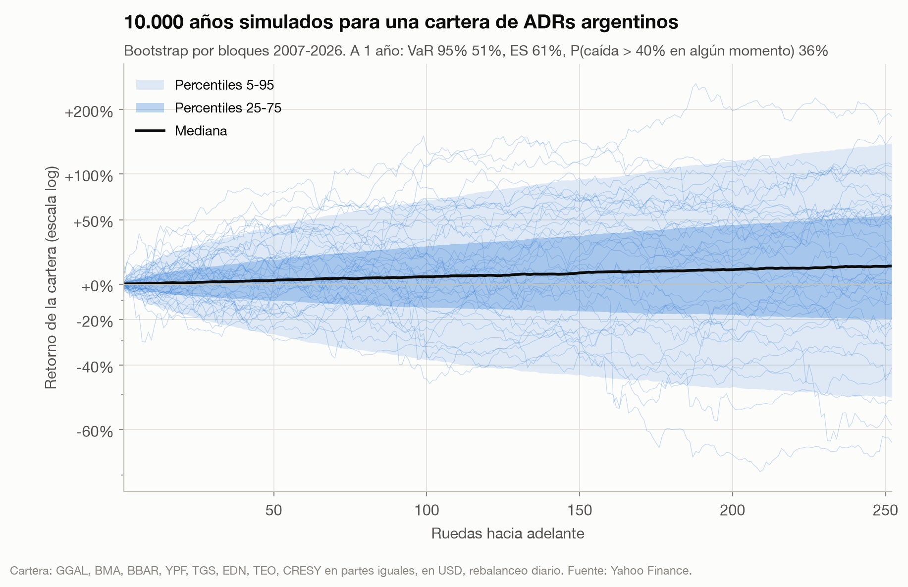

## Resumen

- **Pregunta.** Un banco o un fondo que mide el riesgo de una cartera argentina con el Monte Carlo de manual (retornos normales, covarianza muestral) ¿está midiendo bien el riesgo?
- **Respuesta: no.** Sobre 4.410 días fuera de muestra, el VaR 99% del Monte Carlo normal falló 63 veces contra 44 esperadas (Kupiec p = 0,007), con las fallas agrupadas en crisis (cobertura condicional p < 0,001). Un banco con este modelo habría pasado el 8% de los días en **zona roja** del semáforo de Basilea.
- **Qué funciona.** Cuatro modelos aprueban los cuatro tests (frecuencia, independencia, cobertura condicional y el test Z2 del Expected Shortfall): **Monte Carlo t-Student con covarianza EWMA, simulación histórica filtrada, GARCH(1,1)-t y EVT filtrado**. Lo que tienen en común: **colas gruesas + volatilidad que reacciona**.
- **Lo que ningún modelo ve.** Las PASO de 2019 (−47% la cartera en un día, 18 desvíos estándar). El mejor pronóstico de la noche anterior fue 14%. Para eso existen el ES y los escenarios de estrés, no el VaR.
- **El ruido de Monte Carlo es lo de menos.** Con 5.000 simulaciones el error de simulación es ~4,5% del VaR; la diferencia entre modelos el mismo día es ~43%. Elegir bien el modelo importa 10 veces más que simular más.

## 1. Hipótesis

> **H0:** un VaR 99% a 1 día calculado por Monte Carlo con retornos normales multivariados y covarianza muestral de 500 ruedas tiene una tasa de excepciones del 1%, sin agrupamiento, sobre una cartera equiponderada de ADRs argentinos.

Se rechaza si el test de cobertura condicional de Christoffersen da p < 5%. Antes de mirar resultados se fijaron también las alternativas a comparar, la ventana, el λ de EWMA, la cantidad de simulaciones y la semilla (ver [METODOLOGIA.md](METODOLOGIA.md)).

## 2. Datos

| | |
|---|---|
| Activos | GGAL, BMA, BBAR, YPF, TGS, EDN, TEO, CRESY (ADRs en NYSE/Nasdaq) |
| Cartera | Partes iguales, rebalanceo diario, en USD |
| Fuente | Yahoo Finance, precios ajustados, congelados a CSV en `data/` |
| Muestra | 2007-04-27 a 2026-10-30 (4.910 ruedas) |
| Fuera de muestra | 2009-04-22 a 2026-10-30 (4.410 ruedas, 44 excepciones esperadas al 99%) |

**Por qué ADRs y no acciones locales:** cotizan en dólares, en un mercado líquido y sin los saltos de precio que introducen el cepo y los cambios de régimen cambiario en el peso. El riesgo que medimos es el que ve un inversor en dólares.

**Sesgos que hay que nombrar:**
- *Supervivencia:* son las empresas que hoy siguen listadas. Un universo con las que dejaron de cotizar sería más riesgoso, así que el VaR de este estudio es, si algo, optimista.
- *Selección:* la cartera la elegí yo, por liquidez y representatividad sectorial (bancos, energía, utilities, telecom, real estate). No se probaron otras carteras para elegir la "mejor".

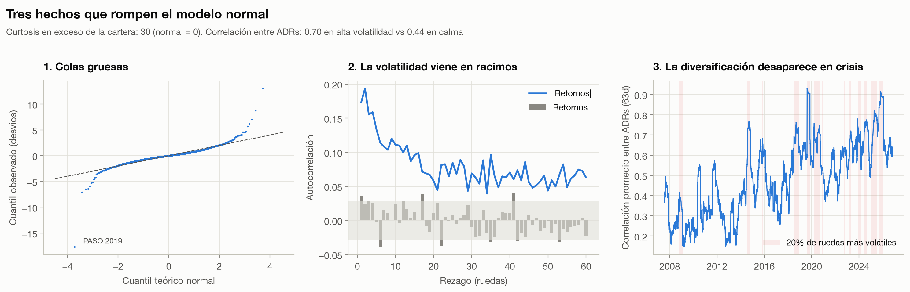

Tres hechos de los datos que anticipan el resultado:
1. **Colas gruesas.** Curtosis en exceso de la cartera: 30 (la normal tiene 0). Cada ADR individual, entre 14 y 18.
2. **Volatilidad en racimos.** Los retornos casi no tienen autocorrelación, pero su valor absoluto sí, y durante más de 60 ruedas.
3. **La diversificación desaparece en crisis.** La correlación promedio entre ADRs es 0,70 en el 20% de ruedas más volátiles vs 0,44 en el resto. Un modelo con covarianza constante sobreestima la diversificación justo cuando importa.

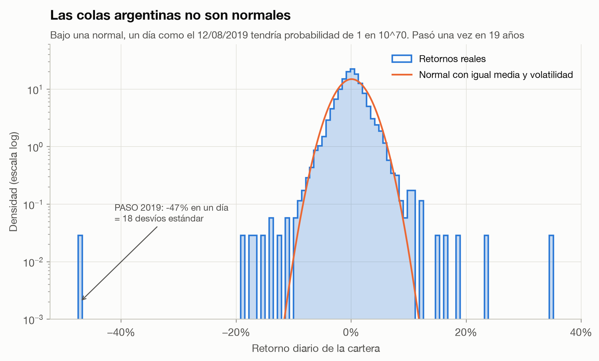

### Análisis descriptivo completo

El capítulo [**Análisis descriptivo de las variables**](estudio/descriptivo/ANALISIS_DESCRIPTIVO.md) mira los datos en detalle antes de evaluar los modelos. Incluye:
- marco teórico y contexto macro de 2007 a 2026;
- una ficha por variable y una sección por cada ADR;
- 28 figuras y más de 40 tablas;
- los tests previos al modelo econométrico.

Lo central:

- **Los días extremos son políticos y locales.** De los 10 peores días de la cartera, 4 son shocks puramente argentinos, con el S&P 500 casi quieto (PASO 2019: −47,1% contra −1,2%). De los 10 mejores, 9 son locales.
- **Las colas son gruesas en las dos direcciones.** La asimetría de cada ADR es ≈ 0, y la t-Student ajustada tiene ν entre 3 y 4. Fuera de ±10% hubo 28 días, cuando la normal predice 0,9.
- **Los ADRs caen juntos más de lo que permite la correlación.** Los 8 estuvieron a la vez en su peor 5% en 17 días; una normal con la misma correlación predice 2,9.
- **El riesgo no se pagó.** La cartera creció 10,4% anual, igual que el S&P 500, con 2,2 veces su volatilidad, una caída máxima de −86% y 6,7 años bajo su máximo.
- **Hacia el modelo.** Los precios son I(1) y los retornos, I(0). El test ARCH-LM rechaza en todas las series. El punto de partida propuesto es un GARCH(1,1) con innovaciones t.

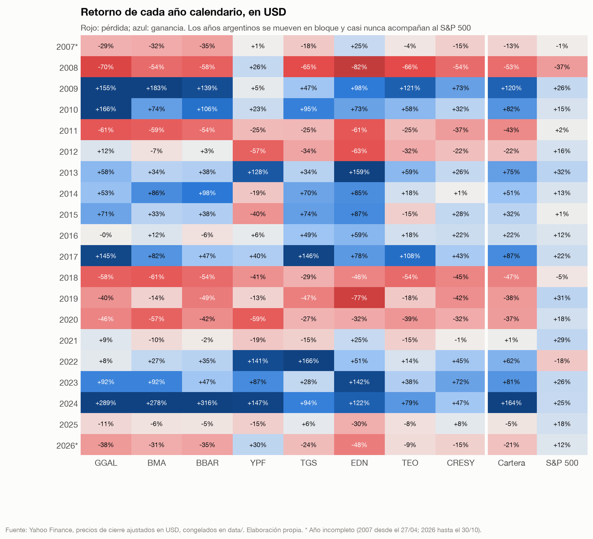

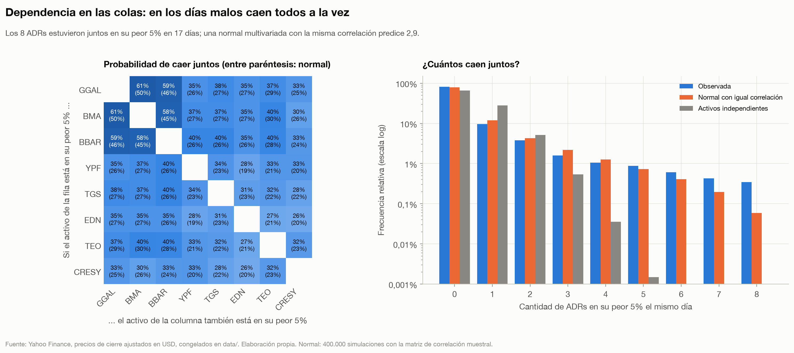

## 3. Modelos

Todos se re-estiman **cada día** usando solo las 500 ruedas anteriores. Nada del día pronosticado entra en el pronóstico.

| Modelo | Distribución | Volatilidad | Idea |
|---|---|---|---|
| Simulación histórica | Empírica | Constante en la ventana | El pasado reciente se repite |
| **MC normal, cov. muestral** | Normal multivariada | Constante | El de manual (H0) |
| MC normal, cov. EWMA | Normal multivariada | EWMA λ = 0,94 (RiskMetrics) | Vol adaptativa, colas finas |
| **MC t-Student, cov. EWMA** | t multivariada (ν estimado mensual) | EWMA | Colas gruesas + **dependencia en las colas** |
| Simulación histórica filtrada | Residuos empíricos | EWMA | Forma empírica, escala de hoy |
| GARCH(1,1)-t | t univariada | GARCH re-ajustado cada 21 días | Estándar académico |
| EVT filtrado | GPD sobre la cola de residuos GARCH | GARCH | McNeil & Frey (2000) |

El detalle que hace funcionar al Monte Carlo t: dividir **todo** el vector normal por un único `sqrt(chi2/ν)` hace que, en un mal escenario, todos los activos caigan juntos. Es dependencia en las colas que la normal multivariada no puede producir, sin importar la correlación que le pongas ([`src/quantkit/risk.py`](src/quantkit/risk.py)).

## 4. Validación

Para cada modelo y cada día se compara la pérdida real con el VaR pronosticado la noche anterior.

| Test | Pregunta | Rechaza si |
|---|---|---|
| Kupiec (POF) | ¿La frecuencia de excepciones es 1%? | p < 0,05 |
| Christoffersen | ¿Las excepciones son independientes o vienen en racimos? | p < 0,05 |
| Cobertura condicional | Las dos cosas a la vez | p < 0,05 |
| Acerbi-Székely Z2 | ¿El ES 97,5% (la métrica de Basilea III) subestima las pérdidas? | Z2 < −0,70 |
| Semáforo de Basilea | Excepciones en las últimas 250 ruedas | 10+ = zona roja |
| Pérdida cuantílica | Ranking entre modelos (scoring rule consistente para cuantiles) | — |

Cada test está verificado contra una respuesta teórica conocida en [`tests/test_risk.py`](tests/test_risk.py) (16 tests).

## 5. Resultados

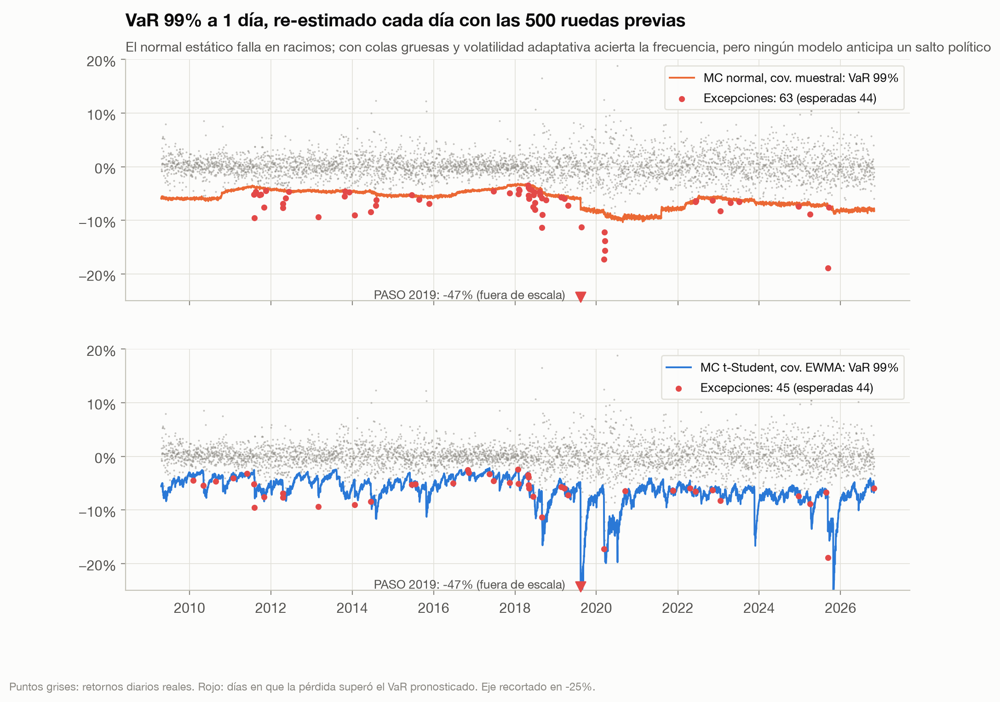

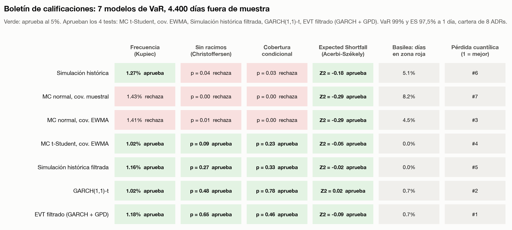

| Modelo | Excepciones (esp. 44) | Kupiec p | Christoffersen p | Cob. cond. p | Días en zona roja | Z2 | Ranking |
|---|---:|---:|---:|---:|---:|---:|---:|
| Simulación histórica | 56 | 0,084 | **0,039** | **0,027** | 5,1% | −0,18 | 6 |
| MC normal, cov. muestral | 63 | **0,007** | **0,002** | **0,000** | 8,2% | −0,29 | 7 |
| MC normal, cov. EWMA | 62 | **0,011** | **0,012** | **0,002** | 4,5% | −0,29 | 3 |
| MC t-Student, cov. EWMA | 45 | 0,892 | 0,088 | 0,231 | 0,0% | −0,05 | 4 |
| Simulación histórica filtrada | 51 | 0,308 | 0,275 | 0,328 | 0,0% | −0,02 | 5 |
| GARCH(1,1)-t | 45 | 0,892 | 0,485 | 0,776 | 0,8% | 0,02 | 2 |
| EVT filtrado | 52 | 0,245 | 0,647 | 0,458 | 0,8% | −0,09 | 1 |

En negrita, rechazos al 5%. Ranking por pérdida cuantílica (menor es mejor).

**Lectura:**
- Pasar de covarianza muestral a EWMA (vol adaptativa) **no alcanza**: sigue fallando. Lo que corrige la frecuencia es agregar **colas gruesas**. Y lo que corrige el agrupamiento es que la volatilidad **reaccione** (EWMA o GARCH). Hacen falta las dos cosas.
- El MC normal con EWMA sale 3º en el ranking aunque falla los tests: la pérdida cuantílica premia reaccionar rápido, y eso lo hace bien. Un buen ranking no reemplaza a pasar los tests de cobertura.
- Ningún modelo es rechazado por el test del ES (Z2 > −0,70 en todos), aunque los tres modelos con colas finas o volatilidad fija tienen los Z2 más negativos.

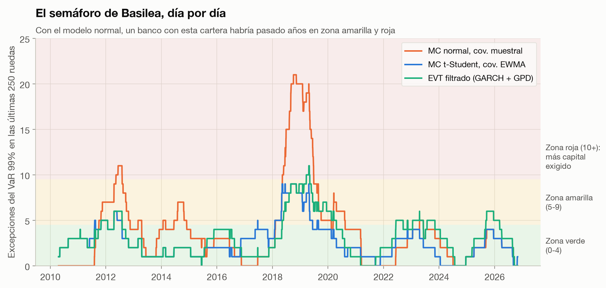

### Los peores días

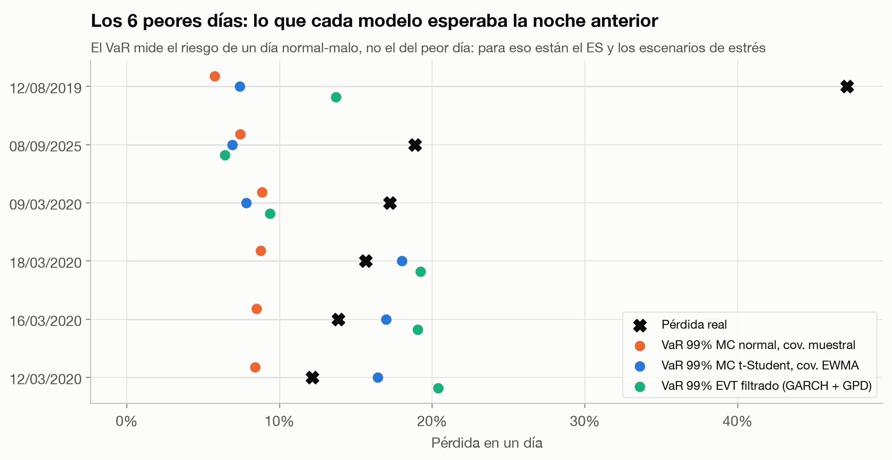

En los días de COVID (marzo 2020) los modelos con volatilidad adaptativa ya habían subido el VaR por encima de la pérdida real. En las PASO 2019 y el 8 de septiembre de 2025 (−18,9%, tras la elección bonaerense) **ninguno** lo anticipó: fueron saltos políticos desde una volatilidad baja. Un modelo estadístico solo extrapola la ventana pasada.

### Monte Carlo: cuántas simulaciones

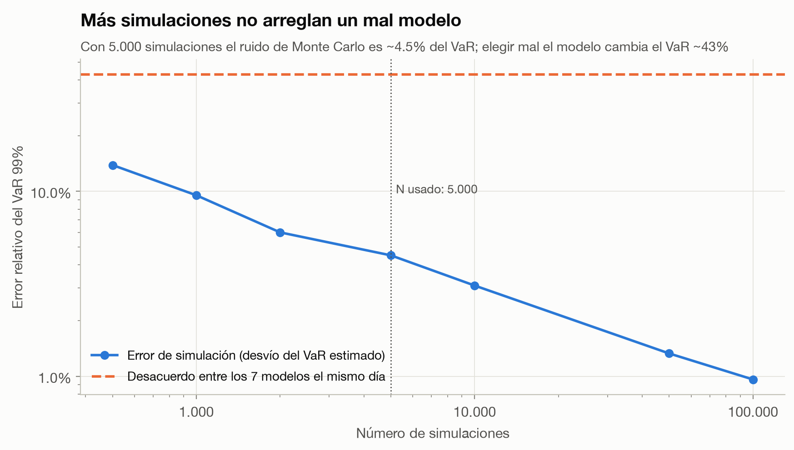

El error de simulación cae como 1/√N. Con N = 5.000 es ~4,5% del VaR (0,29 pp sobre un VaR de 6,4%). La diferencia entre el modelo más alto y el más bajo el mismo día es 43% del VaR mediano. **Más simulaciones no arreglan un mal modelo.**

### Horizonte de 10 días

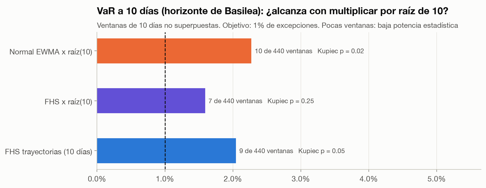

Basilea pide VaR a 10 días y la práctica habitual es multiplicar el de 1 día por √10. Sobre 440 ventanas no superpuestas, la normal × √10 se rechaza (p = 0,02); la FHS × √10 y las trayectorias FHS simuladas día a día (donde un mal primer día sube la volatilidad de los siguientes) no se rechazan. Con 440 ventanas el test tiene poca potencia: es evidencia débil.

### Horizonte de un año

El abanico del principio usa bootstrap por bloques de 20 días (preserva los racimos de volatilidad). A un año, la cartera tiene **VaR 95% de 51%**, ES 95% de 61% y **36% de probabilidad de caer más de 40% en algún momento del año**. Con retornos normales esas cifras serían 44%, 53% y 32%: la normal subestima el riesgo también a horizontes largos.

## 6. Robustez

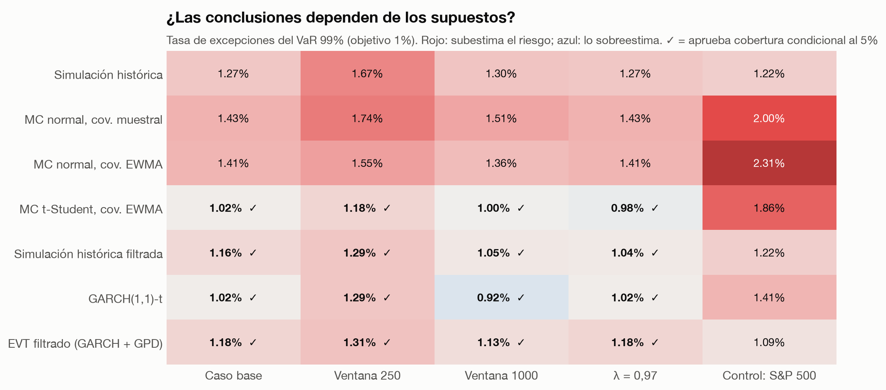

Las conclusiones no dependen de la ventana (250 o 1.000 ruedas) ni de λ (0,97). El **control con el S&P 500** es revelador: allí también falla la normal (2,0% y 2,3% de excepciones), pero el MC t-Student falla también (1,86%) mientras EVT, FHS y simulación histórica pasan. Una explicación posible: en los ADRs argentinos las colas son gruesas en las dos direcciones (asimetría cercana a 0 en cada activo), mientras que en el S&P 500 la cola izquierda pesa más que la derecha y una t simétrica no la captura. No lo testeé formalmente.

## 7. Limitaciones y lo que no funcionó

- **Un piloto previo con acciones de EEUU** rechazó los cuatro modelos que tenía entonces. La simulación histórica filtrada se agregó **después** de ver ese resultado: es una decisión post-hoc y está declarada como tal. Los otros seis modelos estaban fijados antes de correr el estudio argentino.
- **GARCH degenerado.** En 2 de los re-ajustes mensuales (ventanas 2024-2025) la máxima verosimilitud colapsó a varianza constante (α + β ≈ 0). La regla adoptada es conservar el último ajuste válido si α + β < 0,5. Es una decisión de implementación que afecta a GARCH-t y EVT.
- **Trayectorias FHS a 10 días.** Un residuo de −18σ (PASO) multiplicado por una volatilidad de crisis puede generar retornos simulados menores a −100%; se recortan en −99%.
- **Cartera fija, sin posiciones cortas ni derivados.** Una cartera con opciones necesitaría revaluación completa en cada escenario.
- **Supervivencia** (ver Datos) y una sola cartera.
- **Escenarios de estrés hipotéticos:** pendientes (`estudio/escenarios.py`). El informe incluye solo la repetición histórica de las PASO 2019.

## 8. Cómo reproducir

```bash
uv sync
uv run pytest
uv run python estudio/run.py
uv run python estudio/descriptivo/run_descriptivo.py
```

`run.py` regenera las 10 figuras de `estudio/figures/` y las tablas de [`estudio/results.md`](estudio/results.md) en ~80 segundos. Los precios se descargan una vez y quedan congelados en `data/`, así que los números del informe no cambian si Yahoo revisa la historia.

```
src/quantkit/risk.py     modelos de VaR/ES y tests de backtest
src/quantkit/data.py     descarga y caché de precios
estudio/models.py        pronósticos rodantes fuera de muestra
estudio/run.py           análisis, figuras y tablas
estudio/escenarios.py    escenarios de estrés hipotéticos
estudio/descriptivo/     capítulo descriptivo: script, tablas y figuras
tests/test_risk.py       cada modelo contra una respuesta teórica
_archivo/                estudios exploratorios fuera de foco
```

## Referencias

- Kupiec (1995), *Techniques for verifying the accuracy of risk measurement models*.
- Christoffersen (1998), *Evaluating interval forecasts*.
- Barone-Adesi, Giannopoulos & Vosper (1999), *VaR without correlations for portfolios of derivative securities*.
- McNeil & Frey (2000), *Estimation of tail-related risk measures for heteroscedastic financial time series: an extreme value approach*.
- Acerbi & Székely (2014), *Backtesting Expected Shortfall*.
- Comité de Basilea (1996), *Supervisory framework for the use of backtesting*.
- J.P. Morgan/Reuters (1996), *RiskMetrics Technical Document*.
