# Capítulo 2. Análisis descriptivo de las variables

*Estudio: ¿Qué modelo de VaR sobrevive al mercado argentino? Backtest fuera de muestra de 7 modelos sobre una cartera de ADRs argentinos, 2009-2026.*

---

## Índice

- [2.1 Introducción y objetivos del capítulo](#21-introducción-y-objetivos-del-capítulo)
- [2.2 Marco teórico: hechos estilizados y herramientas](#22-marco-teórico-hechos-estilizados-y-herramientas)
- [2.3 Contexto macroeconómico e institucional, 2007-2026](#23-contexto-macroeconómico-e-institucional-2007-2026)
- [2.4 Datos y muestra](#24-datos-y-muestra)
- [2.5 Ficha de cada variable](#25-ficha-de-cada-variable)
- [2.6 Evolución temporal](#26-evolución-temporal)
- [2.7 Estadística descriptiva](#27-estadística-descriptiva)
- [2.8 Forma de la distribución](#28-forma-de-la-distribución)
- [2.9 Los días extremos](#29-los-días-extremos)
- [2.10 Análisis por activo](#210-análisis-por-activo)
- [2.11 Comparación entre activos y composición de la cartera](#211-comparación-entre-activos-y-composición-de-la-cartera)
- [2.12 Dependencia entre activos](#212-dependencia-entre-activos)
- [2.13 Volatilidad y VaR estimado en el tiempo](#213-volatilidad-y-var-estimado-en-el-tiempo)
- [2.14 Estacionalidad](#214-estacionalidad)
- [2.15 Preparación para el modelo econométrico](#215-preparación-para-el-modelo-econométrico)
- [2.16 Conclusiones del capítulo](#216-conclusiones-del-capítulo)
- [2.17 Limitaciones](#217-limitaciones)

---

## 2.1 Introducción y objetivos del capítulo

El capítulo 1 (el [README](../../README.md)) plantea la pregunta del estudio: ¿mide bien el riesgo de una cartera argentina un VaR calculado con el Monte Carlo "de manual", con retornos normales y covarianza constante? La respuesta del backtest es que no, y que los modelos que sobreviven combinan **colas gruesas** con **volatilidad que reacciona**. Este capítulo va un paso atrás: antes de evaluar modelos, mira los datos para entender **por qué** el modelo normal falla y qué tendría que tener un buen modelo.

El análisis descriptivo cumple tres funciones en el trabajo:

1. **Documentar las variables.** Qué mide cada una, cómo se construye, en qué unidades, sobre qué período y por qué se eligió. Sin esto, cualquier resultado posterior es difícil de interpretar o de reproducir.
2. **Establecer los hechos estilizados** de los activos argentinos: la forma de la distribución, cómo cambia la volatilidad, cómo se mueven juntos los activos y qué pasa en los días extremos. Cada hecho tiene una consecuencia directa para la elección del modelo de riesgo.
3. **Preparar el capítulo econométrico.** Los tests de estacionariedad, autocorrelación y heterocedasticidad condicional que cierran el capítulo (sección 2.15) definen la especificación del modelo de volatilidad que se estimará después. Ese modelo **no se estima acá**.

Todo el capítulo se reproduce con un comando, que tarda unos 45 segundos y regenera las 28 figuras, las tablas en CSV y el archivo [`tablas.md`](tablas.md), de donde salen todos los números de este texto:

```bash
uv run python estudio/descriptivo/run_descriptivo.py
```

**Convenciones.** Los retornos son simples, diarios y en dólares. Las cifras diarias y las anualizadas van en tablas separadas. Para anualizar se usan 252 ruedas: la media se multiplica por 252 y el desvío por √252. Los números usan coma decimal y punto de miles. "Rueda" es un día hábil de operaciones en la bolsa de Nueva York.

---

## 2.2 Marco teórico: hechos estilizados y herramientas

Esta sección define las herramientas que se usan en el resto del capítulo. Cada recuadro explica qué mide la herramienta, cómo se interpreta y por qué importa para el riesgo de cola.

### Los hechos estilizados de los retornos financieros

La literatura empírica (Cont, 2001) encontró un conjunto de regularidades que aparecen en casi todos los mercados, países y períodos. Se las llama **hechos estilizados**. Las cinco que importan para este estudio son:

| Hecho estilizado | Qué dice | Consecuencia para el VaR |
|---|---|---|
| **Colas gruesas** | Los días extremos son mucho más frecuentes de lo que predice una normal | Un VaR normal subestima la pérdida en los días malos |
| **Ausencia de autocorrelación lineal** | El retorno de hoy casi no predice el de mañana | La media condicional es aproximadamente constante |
| **Volatilidad en racimos** | Los días agitados vienen juntos; la magnitud de los retornos sí tiene memoria | La volatilidad de mañana se puede pronosticar: el VaR tiene que reaccionar |
| **Correlaciones que suben en crisis** | La diversificación se pierde cuando más se la necesita | Una covarianza constante subestima el riesgo conjunto |
| **Ganancia y pérdida asimétricas** | En índices desarrollados, las caídas son más bruscas que las subas | Puede hacer falta una distribución asimétrica |

El capítulo comprueba cuáles se cumplen en los ADRs argentinos y con qué intensidad. Anticipo el resultado: los cuatro primeros se cumplen con fuerza; el quinto, no.

### Recuadro 1. Retorno simple y log-retorno

El **retorno simple** es $r_t = P_t / P_{t-1} - 1$, y el **log-retorno** es $\ell_t = \ln(P_t / P_{t-1}) = \ln(1 + r_t)$. Para movimientos chicos son casi iguales: $\ell \approx r$ cuando $|r|$ es menor a 2% o 3%. Para movimientos grandes se separan: un $r = -47\%$ equivale a $\ell = -64\%$. Cada uno tiene una propiedad de agregación distinta:

- El **retorno simple** se agrega entre **activos**: el retorno de una cartera es exactamente el promedio ponderado de los retornos simples, $r_p = \sum_i w_i r_i$.
- El **log-retorno** se agrega en el **tiempo**: el log-retorno de una semana es la suma de los cinco diarios.

Como el VaR de este estudio es el de una cartera a un día, la variable correcta es el **retorno simple**.

### Recuadro 2. Momentos: media, desvío, asimetría y curtosis

Para una serie de $N$ retornos con media $\bar r$ y desvío $s$:

- **Media** $\bar r = \frac{1}{N}\sum r_t$: el centro de la distribución. En retornos diarios es pequeñísima frente al desvío, y por eso la media casi no importa para el VaR a un día.
- **Desvío estándar** $s$: la escala típica de los movimientos. Anualizado ($s\sqrt{252}$) es la **volatilidad**.
- **Asimetría** $\frac{1}{N}\sum \left(\frac{r_t - \bar r}{s}\right)^3$: es negativa si la cola izquierda (pérdidas) es más larga que la derecha. Una normal tiene asimetría 0.
- **Curtosis en exceso** $\frac{1}{N}\sum \left(\frac{r_t - \bar r}{s}\right)^4 - 3$: mide cuánto pesan las colas en comparación con una normal, que tiene 0. Si es positiva, la distribución es **leptocúrtica**: tiene un pico más alto, hombros más delgados y colas más largas que la normal.

Al elevar los desvíos a la cuarta potencia, la curtosis le da un peso enorme a unos pocos días extremos. Es una medida muy sensible a valores atípicos, como se verá con el 12/08/2019.

### Recuadro 3. Test de Jarque-Bera

Combina asimetría ($S$) y curtosis en exceso ($K$) en un solo estadístico: $JB = \frac{N}{6}\left(S^2 + \frac{K^2}{4}\right)$. Bajo la hipótesis nula de normalidad se distribuye como una $\chi^2$ con 2 grados de libertad, cuyo valor crítico al 5% es 5,99. Valores muy por encima rechazan la normalidad.

### Recuadro 4. Cuantiles, percentiles y VaR

El percentil $p$ es el valor por debajo del cual queda una proporción $p$ de las observaciones. El **VaR al 99%** es, con el signo cambiado, el percentil 1 de la distribución de retornos **pronosticada para mañana**: la pérdida que solo debería superarse uno de cada cien días. El percentil 1 **histórico** de toda la muestra es un VaR incondicional: no usa la información de cómo está el mercado hoy. Los modelos del estudio son, justamente, distintas maneras de condicionar ese cuantil a la información disponible.

El **Expected Shortfall (ES)** es la pérdida promedio en los días en que se supera el VaR. Responde a la pregunta "cuando las cosas salen mal, ¿cuánto se pierde?", que el VaR no contesta.

### Recuadro 5. La distribución t de Student

Es una distribución simétrica con un parámetro de forma, $\nu$ (los grados de libertad), que controla cuánto pesan las colas: cuanto menor es $\nu$, más gruesas son. Con $\nu \to \infty$ converge a la normal. El momento de orden $k$ existe solo si $\nu > k$: con $\nu \le 4$ la curtosis es infinita, y con $\nu \le 2$ también lo es la varianza. Es la alternativa más usada a la normal en finanzas porque agrega un solo parámetro y captura bien las colas gruesas.

### Recuadro 6. Estacionariedad y raíz unitaria: tests ADF y KPSS

Una serie es (débilmente) **estacionaria** si su media, su varianza y sus autocorrelaciones no cambian con el tiempo. Los precios no lo son: tienen **raíz unitaria** (son I(1)), es decir, los shocks se acumulan y no se disipan. Los retornos, en cambio, suelen ser estacionarios (I(0)). Esto importa porque una regresión entre series no estacionarias puede dar relaciones espurias.

- **ADF (Dickey-Fuller aumentado).** $H_0$: la serie tiene raíz unitaria. Si se rechaza, hay evidencia de estacionariedad.
- **KPSS.** $H_0$: la serie es estacionaria. Si se rechaza, hay evidencia de raíz unitaria.

Como las hipótesis nulas son opuestas, se usan juntos. Si ADF no rechaza y KPSS sí, la serie es I(1). Si ADF rechaza y KPSS no, es I(0).

### Recuadro 7. Autocorrelación, Ljung-Box y ARCH-LM

La **autocorrelación de orden $k$**, $\rho_k = \text{Corr}(r_t, r_{t-k})$, mide si el retorno de hoy se parece al de hace $k$ días. Bajo ruido blanco, $\hat\rho_k$ cae dentro de $\pm 1{,}96/\sqrt{N}$ con 95% de probabilidad.

- **Ljung-Box**, $Q(m) = N(N+2)\sum_{k=1}^{m} \hat\rho_k^2 / (N-k)$. $H_0$: las primeras $m$ autocorrelaciones son todas cero.
- Aplicado a $r_t$, mide la **predictibilidad de la dirección** del retorno. Aplicado a $r_t^2$ o a $|r_t|$, mide la **predictibilidad de la magnitud**, es decir, de la volatilidad.
- **ARCH-LM (Engle, 1982).** Regresa $r_t^2$ sobre sus propios rezagos. $H_0$: no hay heterocedasticidad condicional autorregresiva (efecto ARCH). Si se rechaza, la varianza de mañana depende de los shocks recientes y hace falta un modelo como **GARCH** (Bollerslev, 1986): $\sigma_t^2 = \omega + \alpha r_{t-1}^2 + \beta \sigma_{t-1}^2$.

### Recuadro 8. Dependencia en las colas y coexcedencias

La correlación de Pearson mide co-movimiento lineal **promedio**. No dice si dos activos tienden a tener sus peores días **el mismo día**. Para eso se usa la **coexcedencia**: la probabilidad de que el activo $j$ esté en su peor 5% de días, dado que el activo $i$ lo está. Si los activos fueran independientes, esa probabilidad sería 5%. Si fueran normales con la correlación observada, sería un valor intermedio que se puede calcular por simulación. Si la coexcedencia observada supera a la de la normal, hay **dependencia en las colas** que la correlación no captura.

### Recuadro 9. Drawdown

El **drawdown** en la fecha $t$ es la caída del valor de la inversión desde su máximo previo: $DD_t = V_t / \max_{s \le t} V_s - 1$. La **máxima caída** (*maximum drawdown*) es el peor drawdown de la muestra: lo que perdió quien compró en el peor momento posible. A diferencia de la volatilidad, mide pérdidas acumuladas y su duración.

---

## 2.3 Contexto macroeconómico e institucional, 2007-2026

Los ADRs argentinos son, antes que nada, un termómetro del riesgo país. Para interpretar sus movimientos hace falta el contexto de cada período. Esta sección resume los hechos que se reflejan en los datos. Los mandatos presidenciales se usan como partición del calendario, sin ninguna pretensión de causalidad.

### 2007-2015: Kirchner

La muestra arranca en abril de 2007, al final del gobierno de Néstor Kirchner. En diciembre de 2007 asume Cristina Fernández de Kirchner, que gobierna dos mandatos. Es un período de **creciente intervención estatal y aislamiento financiero**:

- **Intervención del INDEC** (desde 2007), con estadísticas oficiales de inflación poco confiables.
- **Conflicto con el campo** por las retenciones móviles (2008).
- **Crisis financiera global** (septiembre a noviembre de 2008), que en Argentina coincide con la **estatización de las AFJP**, anunciada el 21/10/2008. Las AFJP eran los fondos privados de jubilación y tenían participaciones en muchas empresas locales. La cartera cayó 17,1% y 14,1% en los dos días siguientes al anuncio.
- **Control de cambios** (el "cepo", desde fines de 2011).
- **Expropiación del 51% de YPF** a Repsol (anuncio del 16/04/2012).
- **Default selectivo** de la deuda reestructurada (30/07/2014), tras el fallo de la justicia de Nueva York a favor de los *holdouts*.

En los datos, es el período de **menor volatilidad** de la cartera (34,5% anual; T9). Sin embargo, incluye años de caídas muy fuertes: −53% en 2008, −43% en 2011 y −22% en 2012 (T15). La recuperación de 2013 a 2015 (+75%, +51%, +32%) se dio mientras el mercado anticipaba un cambio de gobierno.

### 2015-2019: Macri

Es un período de **normalización financiera, luego interrumpida**:

- **Salida del cepo** (diciembre de 2015).
- **Acuerdo con los holdouts y regreso a los mercados de deuda** (abril de 2016).
- **Victoria oficialista en las legislativas de 2017.** Ese año la cartera subió 87%.
- **Crisis cambiaria de 2018.** Una corrida contra el peso desde abril llevó a un acuerdo con el FMI en junio, y la corrida de agosto (30/08/2018: −11,4% la cartera) obligó a ampliarlo. La cartera perdió 47% en 2018.
- **PASO del 11/08/2019.** La derrota del oficialismo, mucho más amplia de lo que anticipaban las encuestas, produjo la peor rueda de la muestra al día siguiente: **−47,1% la cartera** y entre −33% y −59% cada ADR. Siguieron el reperfilamiento de la deuda local y el regreso del control de cambios (septiembre de 2019).

Es el período con la **curtosis más alta** (96), casi toda explicada por las PASO.

### 2019-2023: Alberto Fernández

Fue un período de **crisis sanitaria, reestructuración de deuda y alta inflación**:

- **COVID-19 y una cuarentena extensa** (2020). La cartera tuvo cuatro de sus peores diez días en marzo de 2020, en este caso en sintonía con el mercado global.
- **Reestructuración de la deuda con acreedores privados** (oferta mejorada del 06/07/2020: +18,9% la cartera; acuerdo en agosto).
- **Acuerdo de facilidades extendidas con el FMI** (2022).
- **Inflación creciente** (211% anual en 2023) y una amplia brecha entre el dólar oficial y los paralelos.

La volatilidad promedio sube a 49,9% anual. En 2022 la cartera ganó 62% mientras el S&P 500 perdía 18%, sobre todo por YPF (+141%) y TGS (+166%), en un contexto de precios internacionales de la energía altos y desarrollo de Vaca Muerta.

### 2023-2026: Milei

Un período de **ajuste, desinflación y alta sensibilidad política**:

- **Balotaje del 19/11/2023:** +23,5% la cartera al día siguiente.
- **Devaluación de diciembre de 2023, ajuste fiscal** y superávit financiero en 2024. En 2024 la cartera subió **164%**, y los tres bancos, entre 278% y 316%.
- **Nuevo acuerdo con el FMI y salida parcial del cepo** (abril de 2025).
- **Derrota oficialista en la elección bonaerense del 07/09/2025:** −18,9% la cartera al día siguiente, la segunda peor rueda de la muestra.
- **Apoyo financiero del Tesoro de EE. UU.**, anunciado el 22/09/2025 (+15,3%) y ampliado el 09/10/2025 con compras de pesos y un *swap* (+12,2%).
- **Triunfo oficialista en las legislativas del 26/10/2025:** **+34,9%** la cartera al día siguiente, la mejor rueda de la muestra.
- **2026:** hasta el 30/10 la cartera cae 21% mientras el S&P 500 sube 12%. Esa caída se analiza en el repositorio hermano [riesgo-politico-latam](https://github.com/babottomas561-cell/riesgo-politico-latam), que atribuye la mayor parte a factores locales.

Es el período de **mayor volatilidad** (51,2% anual) y con los dos días más extremos de la muestra en las dos direcciones.

**Lo que muestra este recorrido:** los días más extremos de la cartera no son, en su mayoría, crisis globales. Son **elecciones y decisiones de política económica locales**. Ese es el tipo de riesgo que un modelo estadístico, que solo extrapola la ventana pasada, tiene más dificultades para anticipar.

---

## 2.4 Datos y muestra

| | |
|---|---|
| Fuente | Yahoo Finance, precios de cierre **ajustados** por dividendos y splits |
| Congelamiento | Descargados una vez y guardados en `data/` (CSV), para que los números no cambien si Yahoo revisa la historia |
| Mercado | NYSE / Nasdaq, en USD |
| Frecuencia | Diaria (ruedas hábiles de EE. UU.) |
| Período de precios | 26/04/2007 a 30/10/2026 |
| Período de retornos | 27/04/2007 a 30/10/2026: **4.910 ruedas**. El SPY tiene 4.909 porque su caché empieza un día después |
| Período del VaR fuera de muestra | 22/04/2009 a 30/10/2026: 4.410 ruedas. Las primeras 500 se usan solo para estimar |
| Activos | GGAL, BMA, BBAR, YPF, TGS, EDN, TEO y CRESY, más el SPY como control |

**Por qué empieza en 2007.** Es la fecha más temprana en la que los ocho ADRs tienen precio todos los días. Como el panel es rectangular, la muestra la define el activo que empezó a cotizar más tarde.

**Alineación de calendarios.** Los ocho ADRs y el SPY cotizan en el mismo calendario (NYSE). Aun así, el panel se arma con la regla general del repo: se conservan los días en que operó el SPY y los precios faltantes se completan hacia adelante (`p[p["SPY"].notna()].ffill()`) antes de calcular retornos. Así, un feriado que afecte a un solo listado no borra el retorno del día siguiente en todo el panel. En esta muestra la regla no cambia ningún dato: los retornos de los ADRs son idénticos a los de `estudio/run.py`, y el backtest reproduce exactamente las excepciones del informe (63, 62, 45, 51, 45 y 52; ver T11).

---

## 2.5 Ficha de cada variable

### V1. Precio de cierre ajustado de cada ADR, $P_{i,t}$

- **Qué es.** El precio en dólares de un *American Depositary Receipt*, un certificado que cotiza en Nueva York y representa acciones de una empresa argentina.
- **Construcción.** Cierre diario ajustado por dividendos y splits (Yahoo, `auto_adjust=True`). Unidades: USD por ADR. En las figuras se expresa en base 100 al 26/04/2007.
- **Por qué se eligió.** Es la variable primaria de la que sale todo lo demás. Se usan **ADRs y no acciones locales** porque cotizan en dólares, en un mercado líquido y sin los saltos que introducen el cepo y los cambios de régimen cambiario en el precio en pesos. El riesgo que se mide es el que ve un inversor en dólares.
- **Los 8 activos** se eligieron por liquidez y cobertura sectorial, sin optimizar. La sección 2.10 describe cada empresa.

### V2. Retorno diario simple de cada ADR, $r_{i,t} = P_{i,t}/P_{i,t-1} - 1$

- **Qué es.** La variación porcentual diaria del precio en dólares, con los dividendos incluidos.
- **Construcción.** A partir de V1, con frecuencia diaria. Es una proporción: −0,05 equivale a −5%.
- **Por qué retorno simple y no log-retorno.** Como explica el Recuadro 1, solo el retorno simple se agrega linealmente entre activos. Además, el logaritmo deforma justo la cola que interesa: el −47,1% de las PASO es −63,8% en logaritmos, y la curtosis de la cartera pasa de 30 a 68. La media de los log-retornos solo se reporta en T2, para medir el crecimiento compuesto.
- **Por qué se eligió.** El VaR es un cuantil de esta variable. Todo lo que el modelo tiene que capturar se ve primero acá.

### V3. Retorno de la cartera equiponderada, $r_{p,t} = \sum_{i=1}^{8} \tfrac{1}{8}\, r_{i,t}$

- **Qué es.** El retorno diario de invertir 12,5% en cada ADR, rebalanceando todos los días a pesos iguales.
- **Por qué se eligió.** Es la **variable objetivo del estudio**: el VaR que se backtestea es el de esta cartera. Los pesos iguales evitan elegir la cartera mirando los resultados, que sería sesgo de selección. Sin embargo, como se ve en 2.11, pesos iguales por activo no implican pesos iguales por sector ni por riesgo.

### V4. Retorno del S&P 500 (ETF SPY), $r_{m,t}$

- **Qué es.** El retorno diario del ETF que replica el índice S&P 500, construido igual que V2.
- **Por qué se eligió.** Es el **grupo de control**. En el capítulo de robustez del estudio, los mismos modelos de VaR se corren sobre el SPY para separar lo que es propio de Argentina de lo que tiene cualquier mercado accionario. Por eso aparece en todas las tablas como referencia. También permite distinguir en cada día extremo si el shock fue global o local (sección 2.9).

### V5. Volatilidad condicional EWMA de la cartera, $\sigma_t$

- **Qué es.** Un promedio exponencialmente ponderado de los retornos al cuadrado pasados (RiskMetrics, 1996): $\sigma_t^2 = \lambda\,\sigma_{t-1}^2 + (1-\lambda)\, r_{p,t-1}^2$, con $\lambda = 0{,}94$. Cada día, la observación más reciente pesa 6% y el resto decae geométricamente.
- **Construcción.** Ex ante: la volatilidad del día $t$ usa información hasta $t-1$. Se inicializa con la varianza de las primeras 20 ruedas, que se descartan en las tablas. Se mide como desvío diario y se anualiza por √252 en los gráficos.
- **Por qué se eligió.** Es la pieza que hace "reaccionar" a tres de los siete modelos (MC normal y MC t con covarianza EWMA, y simulación histórica filtrada). GARCH-t y EVT usan su generalización, el GARCH(1,1). Como referencia más simple se agrega el **desvío móvil de 63 ruedas** (un trimestre bursátil), que pondera igual los últimos 63 días.

### V6. VaR 99% a un día de cada modelo, $\widehat{VaR}_{t}^{(m)}$, e indicador de excepción $I_t^{(m)} = \mathbb{1}\{r_{p,t} < -\widehat{VaR}_t^{(m)}\}$

- **Qué es.** La pérdida que, según el modelo $m$, solo debería superarse el 1% de los días, expresada como pérdida positiva en proporción del valor de la cartera. El indicador vale 1 los días en que la pérdida real superó al VaR.
- **Construcción.** Pronósticos rodantes estrictamente fuera de muestra (`estudio/models.py`): para cada día $t$, cada modelo usa solo las 500 ruedas previas. Son siete modelos (ver el README).
- **Por qué se eligió.** Es la **variable que se evalúa**. Los tests de Kupiec y Christoffersen son tests sobre la serie binaria $I_t$: su frecuencia tiene que ser 1% y no debe tener racimos. Describirla antes de testearla muestra *cómo* falla cada modelo, no solo *si* falla.

### V7. Sector económico (variable cualitativa)

- **Qué es.** La clasificación de cada ADR en cinco sectores: bancos (GGAL, BMA, BBAR), petróleo y gas (YPF, TGS), electricidad (EDN), telecomunicaciones (TEO) y agro e inmobiliario (CRESY).
- **Por qué se eligió.** Es la única composición real del estudio. Permite ver cuánto pesa cada sector en la cartera y cuánto aporta al riesgo (2.11).

### Eventos de referencia

En las series de tiempo se marcan seis fechas. En rojo van las dos que pide el estudio, ambas saltos políticos desde una volatilidad baja; en gris, el contexto.

| # | Fecha | Evento | Cartera ese día | S&P 500 ese día |
|---|---|---|---:|---:|
| 1 | 21/10/2008 | Anuncio de la estatización de las AFJP, en plena crisis global | −17,1% | −3,0% |
| **2** | **12/08/2019** | **PASO 2019** | **−47,1%** | **−1,2%** |
| 3 | 09/03/2020 | COVID-19 y guerra de precios del petróleo | −17,2% | −7,8% |
| 4 | 20/11/2023 | Balotaje 2023 | +23,5% | +0,8% |
| **5** | **08/09/2025** | **Elección bonaerense** | **−18,9%** | **+0,2%** |
| 6 | 27/10/2025 | Elecciones legislativas nacionales | +34,9% | +1,2% |

---

## 2.6 Evolución temporal

### Precios

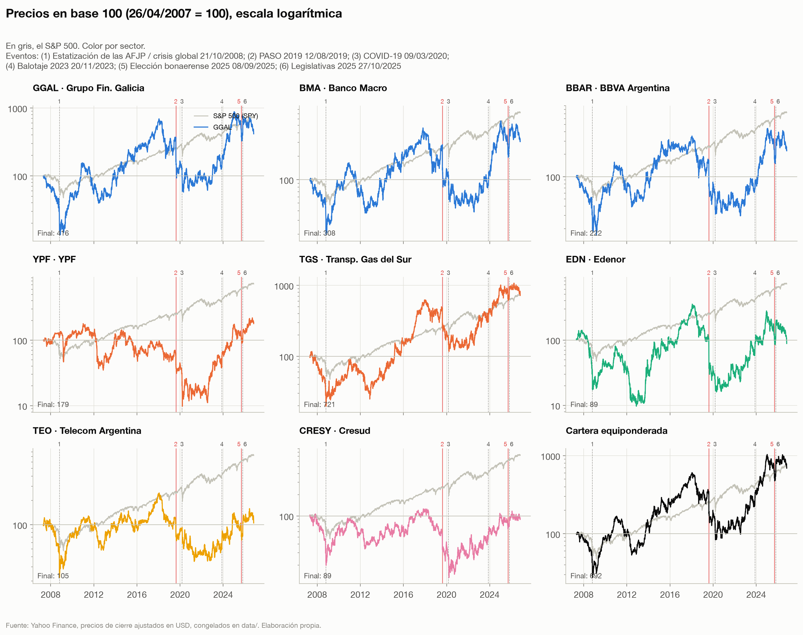

**Figura 1. Precios en base 100, escala logarítmica.** Se usa escala logarítmica para que distancias verticales iguales representen variaciones porcentuales iguales. Hay tres lecturas:

1. **Ningún ADR tuvo una tendencia estable.** El S&P 500 (gris) sube de forma casi monótona. Los ADRs alternan ciclos de varias veces su valor y caídas de 80% a 95%. Varios terminan la muestra cerca o por debajo de su valor inicial en dólares: EDN y CRESY en 89, y TEO en 105, después de 19 años.
2. **Los quiebres son comunes a todos los activos.** La caída de 2008, el desplome del 12/08/2019 (línea roja 2) y la recuperación desde fines de 2023 aparecen en los ocho paneles a la vez. Es riesgo **país**, no riesgo de empresa, y anticipa las correlaciones altas de la sección 2.12.
3. **La cartera multiplicó por 6,9 su valor, pero con una caída máxima de −86%.** Ganó algo parecido al S&P 500 por un camino mucho más violento.

### Retornos diarios

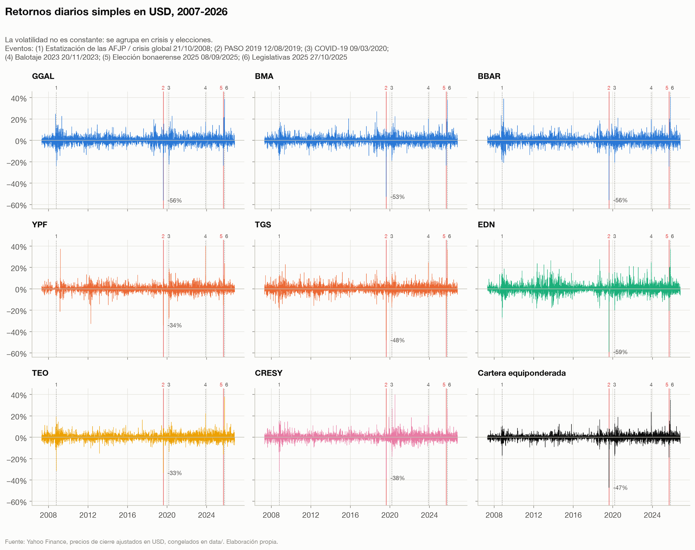

**Figura 2. Retornos diarios.** La serie oscila alrededor de cero, pero su amplitud **cambia en el tiempo**: hay tramos tranquilos (2016-2017) y tramos agitados (fines de 2008, 2018, 2019-2020, 2025). Es la primera evidencia visual de heterocedasticidad condicional, que la sección 2.15 testea formalmente. Los mínimos de los ocho ADRs, entre −33% y −59%, ocurren **todos el 12/08/2019**: las PASO fueron el peor día de la historia de cada uno.

### Retornos y volatilidad por año calendario

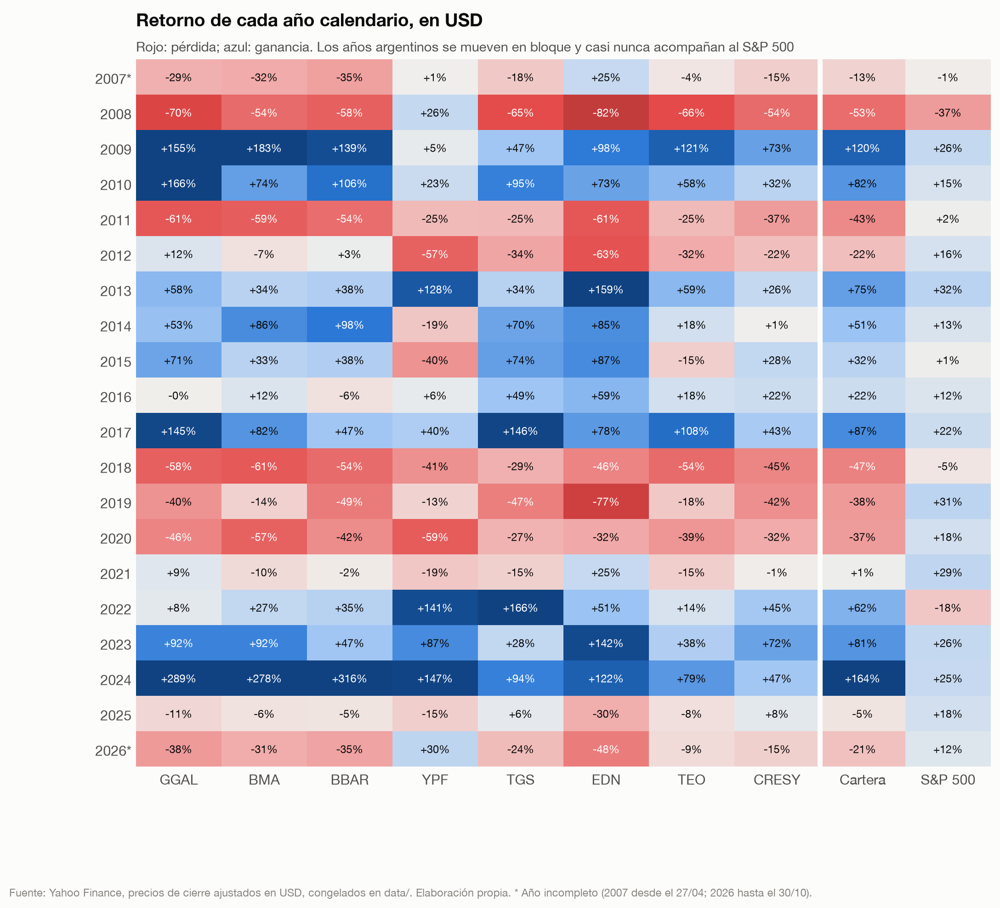

**Tabla 15. Retorno de cada año calendario, en USD** (2007 y 2026 son años incompletos).

| Año   | GGAL   | BMA   | BBAR   | YPF   | TGS   | EDN   | TEO   | CRESY   | Cartera   | S&P 500 (SPY)   |
|:------|:-------|:------|:-------|:------|:------|:------|:------|:--------|:----------|:----------------|
| 2007  | -29%   | -32%  | -35%   | 1%    | -18%  | 25%   | -4%   | -15%    | -13%      | -1%             |
| 2008  | -70%   | -54%  | -58%   | 26%   | -65%  | -82%  | -66%  | -54%    | -53%      | -37%            |
| 2009  | 155%   | 183%  | 139%   | 5%    | 47%   | 98%   | 121%  | 73%     | 120%      | 26%             |
| 2010  | 166%   | 74%   | 106%   | 23%   | 95%   | 73%   | 58%   | 32%     | 82%       | 15%             |
| 2011  | -61%   | -59%  | -54%   | -25%  | -25%  | -61%  | -25%  | -37%    | -43%      | 2%              |
| 2012  | 12%    | -7%   | 3%     | -57%  | -34%  | -63%  | -32%  | -22%    | -22%      | 16%             |
| 2013  | 58%    | 34%   | 38%    | 128%  | 34%   | 159%  | 59%   | 26%     | 75%       | 32%             |
| 2014  | 53%    | 86%   | 98%    | -19%  | 70%   | 85%   | 18%   | 1%      | 51%       | 13%             |
| 2015  | 71%    | 33%   | 38%    | -40%  | 74%   | 87%   | -15%  | 28%     | 32%       | 1%              |
| 2016  | -0%    | 12%   | -6%    | 6%    | 49%   | 59%   | 18%   | 22%     | 22%       | 12%             |
| 2017  | 145%   | 82%   | 47%    | 40%   | 146%  | 78%   | 108%  | 43%     | 87%       | 22%             |
| 2018  | -58%   | -61%  | -54%   | -41%  | -29%  | -46%  | -54%  | -45%    | -47%      | -5%             |
| 2019  | -40%   | -14%  | -49%   | -13%  | -47%  | -77%  | -18%  | -42%    | -38%      | 31%             |
| 2020  | -46%   | -57%  | -42%   | -59%  | -27%  | -32%  | -39%  | -32%    | -37%      | 18%             |
| 2021  | 9%     | -10%  | -2%    | -19%  | -15%  | 25%   | -15%  | -1%     | 1%        | 29%             |
| 2022  | 8%     | 27%   | 35%    | 141%  | 166%  | 51%   | 14%   | 45%     | 62%       | -18%            |
| 2023  | 92%    | 92%   | 47%    | 87%   | 28%   | 142%  | 38%   | 72%     | 81%       | 26%             |
| 2024  | 289%   | 278%  | 316%   | 147%  | 94%   | 122%  | 79%   | 47%     | 164%      | 25%             |
| 2025  | -11%   | -6%   | -5%    | -15%  | 6%    | -30%  | -8%   | 8%      | -5%       | 18%             |
| 2026  | -38%   | -31%  | -35%   | 30%   | -24%  | -48%  | -9%   | -15%    | -21%      | 12%             |

**Figura 3. Mapa de calor de los retornos anuales.** Hay cuatro lecturas:

- **Los años argentinos se mueven en bloque.** En la mayoría de los años, los ocho ADRs tienen el mismo signo. En 2008, 2011, 2018, 2019 y 2020 casi todos pierden; en 2009, 2010, 2013, 2017, 2023 y 2024, casi todos ganan.
- **Las magnitudes son extremas.** Hay retornos anuales de +316% (BBAR en 2024) y de −82% (EDN en 2008). En 20 años, el S&P 500 nunca superó +32% ni perdió más de 37%.
- **El ciclo argentino no es el ciclo global.** En 2019 el S&P 500 ganó 31% y la cartera perdió 38%. En 2022 fue al revés: la cartera ganó 62% y el S&P 500 perdió 18%.
- **Hay excepciones sectoriales.** YPF ganó 26% en 2008, el único ADR en positivo, y perdió 57% en 2012, el año de la expropiación, mientras los bancos quedaban casi sin cambios.

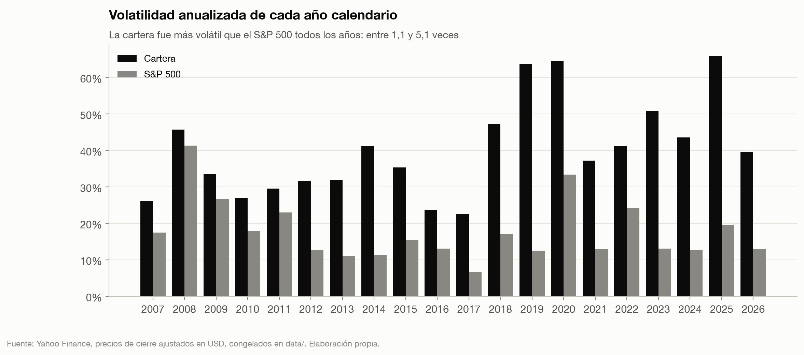

**Tabla 16. Volatilidad anualizada de cada año calendario.**

| Año   | GGAL   | BMA   | BBAR   | YPF   | TGS   | EDN   | TEO   | CRESY   | Cartera   | S&P 500 (SPY)   |
|:------|:-------|:------|:-------|:------|:------|:------|:------|:--------|:----------|:----------------|
| 2007  | 36%    | 36%   | 41%    | 32%   | 48%   | 35%   | 46%   | 44%     | 26%       | 18%             |
| 2008  | 76%    | 71%   | 94%    | 30%   | 69%   | 68%   | 72%   | 69%     | 46%       | 41%             |
| 2009  | 65%    | 59%   | 70%    | 64%   | 66%   | 59%   | 51%   | 48%     | 33%       | 27%             |
| 2010  | 47%    | 38%   | 45%    | 30%   | 44%   | 46%   | 35%   | 39%     | 27%       | 18%             |
| 2011  | 45%    | 45%   | 45%    | 37%   | 47%   | 47%   | 32%   | 33%     | 30%       | 23%             |
| 2012  | 53%    | 46%   | 52%    | 66%   | 57%   | 79%   | 40%   | 38%     | 32%       | 13%             |
| 2013  | 47%    | 43%   | 51%    | 44%   | 40%   | 90%   | 41%   | 34%     | 32%       | 11%             |
| 2014  | 51%    | 55%   | 56%    | 53%   | 51%   | 73%   | 40%   | 39%     | 41%       | 11%             |
| 2015  | 45%    | 51%   | 50%    | 42%   | 47%   | 54%   | 38%   | 36%     | 35%       | 15%             |
| 2016  | 33%    | 36%   | 37%    | 37%   | 30%   | 35%   | 27%   | 38%     | 24%       | 13%             |
| 2017  | 32%    | 39%   | 30%    | 33%   | 35%   | 29%   | 35%   | 30%     | 23%       | 7%              |
| 2018  | 70%    | 69%   | 67%    | 42%   | 54%   | 65%   | 40%   | 39%     | 47%       | 17%             |
| 2019  | 83%    | 81%   | 82%    | 52%   | 70%   | 81%   | 53%   | 59%     | 64%       | 13%             |
| 2020  | 85%    | 83%   | 86%    | 84%   | 65%   | 74%   | 59%   | 83%     | 65%       | 33%             |
| 2021  | 47%    | 48%   | 52%    | 56%   | 41%   | 63%   | 39%   | 55%     | 37%       | 13%             |
| 2022  | 46%    | 47%   | 53%    | 57%   | 55%   | 60%   | 46%   | 63%     | 41%       | 24%             |
| 2023  | 59%    | 60%   | 64%    | 66%   | 58%   | 71%   | 59%   | 52%     | 51%       | 13%             |
| 2024  | 54%    | 56%   | 62%    | 44%   | 51%   | 56%   | 53%   | 41%     | 44%       | 13%             |
| 2025  | 78%    | 78%   | 82%    | 59%   | 68%   | 85%   | 66%   | 52%     | 66%       | 19%             |
| 2026  | 50%    | 52%   | 60%    | 39%   | 38%   | 52%   | 50%   | 41%     | 40%       | 13%             |

**Figura 4. Volatilidad anual de la cartera y del S&P 500.** La cartera fue más volátil que el S&P 500 **todos los años**, entre 1,1 y 5,1 veces. La razón es mínima en 2008 (46% contra 41%), cuando el shock era global. Es máxima en años de calma internacional y turbulencia local: en 2019 la cartera tuvo 64% de volatilidad y el S&P 500, 13%. Desde 2018 la volatilidad de la cartera no bajó de 37% en ningún año, mientras que entre 2010 y 2017 se movía entre 23% y 41%. **El régimen de volatilidad cambió de nivel**, algo que el capítulo econométrico tendrá que considerar.

### Drawdowns

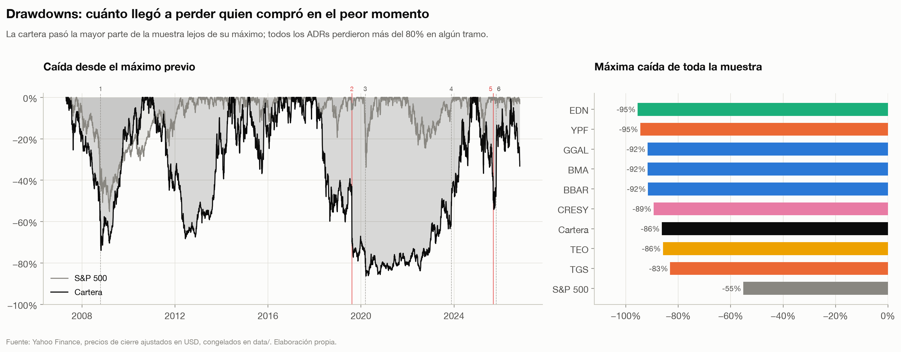

**Tabla 17. Los cinco mayores episodios de caída de la cartera.**

| #   | Máximo previo   | Mínimo     | Caída   | Ruedas hasta el mínimo   | Recuperación   | Ruedas bajo el máximo   |
|:----|:----------------|:-----------|:--------|:-------------------------|:---------------|:------------------------|
| 1   | 18/01/2018      | 19/03/2020 | -86,3%  | 545                      | 19/09/2024     | 1.678                   |
| 2   | 01/06/2007      | 27/10/2008 | -73,9%  | 355                      | 05/08/2010     | 801                     |
| 3   | 19/01/2011      | 13/06/2012 | -68,3%  | 353                      | 05/05/2014     | 827                     |
| 4   | 07/01/2025      | 19/09/2025 | -54,1%  | 175                      | sin recuperar  | 456                     |
| 5   | 20/03/2015      | 28/09/2015 | -36,8%  | 132                      | 20/06/2016     | 315                     |

**Figura 5. Caída desde el máximo previo.** El S&P 500 (gris) perdió 55% en 2008-2009 y pasó la mayor parte de la muestra a menos de 20% de su máximo. La cartera (negro) pasó **la mayor parte de la muestra lejos de su máximo**. Su peor episodio empezó el 18/01/2018, tocó fondo el 19/03/2020 con **−86,3%** y recién recuperó el máximo el 19/09/2024: **1.678 ruedas, unos 6,7 años**, bajo el máximo previo. Además, la cartera tiene cinco episodios de más de 35% de caída en 19 años, y el episodio iniciado en enero de 2025 (−54,1%) todavía no se recuperó al cierre de la muestra. Ningún ADR individual se salvó de perder más de 80% en algún tramo (panel derecho).

---

## 2.7 Estadística descriptiva

### Retornos diarios

**Tabla 1. Estadística descriptiva de los retornos diarios** (27/04/2007 a 30/10/2026; momentos en %, salvo asimetría, curtosis y JB).

|               | N     | Media   | Mediana   | Desvío   | Mín.    | Máx.   | P1     | P5     | P95   | P99    | Asimetría   | Curtosis exceso   | Jarque-Bera   | JB p    |
|:--------------|:------|:--------|:----------|:---------|:--------|:-------|:-------|:-------|:------|:-------|:------------|:------------------|:--------------|:--------|
| GGAL          | 4.910 | 0,10%   | 0,00%     | 3,63%    | -56,12% | 38,70% | -8,21% | -5,14% | 5,71% | 10,53% | -0,25       | 18,3              | 68.423        | < 0,001 |
| BMA           | 4.910 | 0,09%   | -0,06%    | 3,58%    | -52,67% | 37,63% | -8,29% | -5,23% | 5,61% | 10,07% | -0,13       | 15,7              | 50.416        | < 0,001 |
| BBAR          | 4.910 | 0,09%   | 0,00%     | 3,87%    | -55,85% | 40,75% | -9,22% | -5,58% | 6,20% | 10,86% | 0,02        | 16,0              | 52.067        | < 0,001 |
| YPF           | 4.910 | 0,06%   | 0,00%     | 3,19%    | -34,05% | 39,89% | -7,79% | -4,37% | 5,01% | 8,39%  | 0,20        | 18,5              | 70.042        | < 0,001 |
| TGS           | 4.910 | 0,10%   | 0,00%     | 3,35%    | -48,04% | 36,79% | -7,98% | -4,75% | 5,30% | 9,47%  | -0,06       | 14,8              | 44.582        | < 0,001 |
| EDN           | 4.910 | 0,08%   | -0,08%    | 4,02%    | -58,98% | 36,95% | -9,40% | -5,54% | 6,35% | 12,73% | 0,09        | 15,3              | 47.828        | < 0,001 |
| TEO           | 4.910 | 0,05%   | 0,00%     | 2,99%    | -33,38% | 37,50% | -7,11% | -4,40% | 4,66% | 8,22%  | 0,10        | 14,2              | 41.054        | < 0,001 |
| CRESY         | 4.910 | 0,04%   | 0,00%     | 3,06%    | -38,09% | 39,80% | -7,07% | -4,39% | 4,67% | 8,80%  | 0,43        | 17,7              | 64.382        | < 0,001 |
| Cartera       | 4.910 | 0,08%   | 0,07%     | 2,67%    | -47,15% | 34,86% | -6,37% | -3,81% | 4,19% | 6,94%  | -0,50       | 30,4              | 189.370       | < 0,001 |
| S&P 500 (SPY) | 4.909 | 0,05%   | 0,07%     | 1,24%    | -10,94% | 14,52% | -3,58% | -1,81% | 1,69% | 3,29%  | 0,01        | 14,6              | 43.305        | < 0,001 |

*Curtosis en exceso: la normal tiene 0. JB: estadístico de Jarque-Bera, $H_0$: normalidad (valor crítico al 5%: 5,99).*

**Lectura.**

- **Centro.** La media diaria es positiva pero minúscula frente al desvío: entre 0,04% y 0,10% por día, contra un desvío de 3% a 4%. La mediana es casi exactamente cero en varios ADRs, porque entre el 0,6% (BMA) y el 4,4% (TGS) de los días el precio **no cambió** (cierres sin operaciones o con muy poco volumen). Eso explica el pico en cero que se ve en los histogramas.
- **Dispersión.** El desvío diario de los ADRs va de 3,0% a 4,0%, entre 2,4 y 3,2 veces el del S&P 500 (1,24%). La cartera baja a 2,67% gracias a la diversificación, pero sigue siendo más del doble que el SPY.
- **Colas.** El percentil 1 de la cartera es −6,37%: es el **VaR 99% histórico incondicional** (uno de cada cien días se pierde más que eso). Bajo una normal con el mismo desvío, ese percentil estaría en −6,1%. El número se parece, pero lo que pasa *más allá* de ese percentil es muy distinto (ver T5).
- **Asimetría.** Es cercana a cero en cada ADR, entre −0,25 y +0,43. A diferencia de lo que se observa en los índices desarrollados, la cola izquierda no pesa sistemáticamente más que la derecha: Argentina tiene días de −50% y también de +35%. La cartera es la excepción (−0,50), y eso se debe casi entero a un solo día: sin las PASO, su asimetría es **+0,68**.
- **Curtosis.** Está entre 14 y 18,5 en cada ADR y llega a **30 en la cartera**. Normalmente diversificar reduce la curtosis; acá la aumenta, porque en los días extremos todos los activos se mueven juntos (2.12). La diversificación reduce la varianza de los días normales, pero no la de los extremos. Sin las PASO, la curtosis de la cartera baja a 12: una sola observación duplica el estadístico.
- **Normalidad.** Jarque-Bera rechaza la normalidad en todas las series con p prácticamente nulo. Los estadísticos, de 41.000 a 189.000, superan miles de veces el valor crítico de 5,99.

### Retornos y riesgo anualizados

**Tabla 2. Retornos y riesgo anualizados.**

|               | Media aritmética anual   | Media log anual   | Crecimiento anual compuesto   | Volatilidad anual   | Máxima caída acumulada   |
|:--------------|:-------------------------|:------------------|:------------------------------|:--------------------|:-------------------------|
| GGAL          | 24,3%                    | 7,3%              | 7,6%                          | 57,6%               | -91,7%                   |
| BMA           | 22,2%                    | 5,8%              | 5,9%                          | 56,8%               | -91,7%                   |
| BBAR          | 23,3%                    | 4,1%              | 4,2%                          | 61,4%               | -91,5%                   |
| YPF           | 15,8%                    | 3,0%              | 3,0%                          | 50,6%               | -94,5%                   |
| TGS           | 24,4%                    | 10,1%             | 10,7%                         | 53,1%               | -83,1%                   |
| EDN           | 20,1%                    | -0,6%             | -0,6%                         | 63,7%               | -95,5%                   |
| TEO           | 11,6%                    | 0,3%              | 0,3%                          | 47,4%               | -85,9%                   |
| CRESY         | 11,2%                    | -0,6%             | -0,6%                         | 48,6%               | -89,4%                   |
| Cartera       | 19,1%                    | 9,9%              | 10,4%                         | 42,4%               | -86,3%                   |
| S&P 500 (SPY) | 12,1%                    | 10,1%             | 10,7%                         | 19,6%               | -55,2%                   |

*Media aritmética anual = media diaria × 252. Media log anual = media de ln(1 + r) × 252. Crecimiento anual compuesto = (valor final / valor inicial)^(1/años) − 1.*

**Lectura.** La diferencia entre la primera y la segunda columna es el **costo de la volatilidad** (*volatility drag*), que es aproximadamente $\sigma^2/2$. El caso extremo es EDN: tiene una media aritmética de +20,1% anual y un crecimiento compuesto de −0,6%. Con 64% de volatilidad, el promedio de los retornos diarios dice que se gana, pero el inversor que mantuvo el ADR perdió plata. En activos tan volátiles, la media aritmética anualizada **no** sirve como medida de rendimiento.

La cartera creció 10,4% anual compuesto, casi lo mismo que el S&P 500 (10,7%), con 2,2 veces su volatilidad y una caída máxima de −86% contra −55%. Medido por unidad de riesgo, el inversor en ADRs argentinos **no fue compensado** en esta muestra.

---

## 2.8 Forma de la distribución

### Histogramas

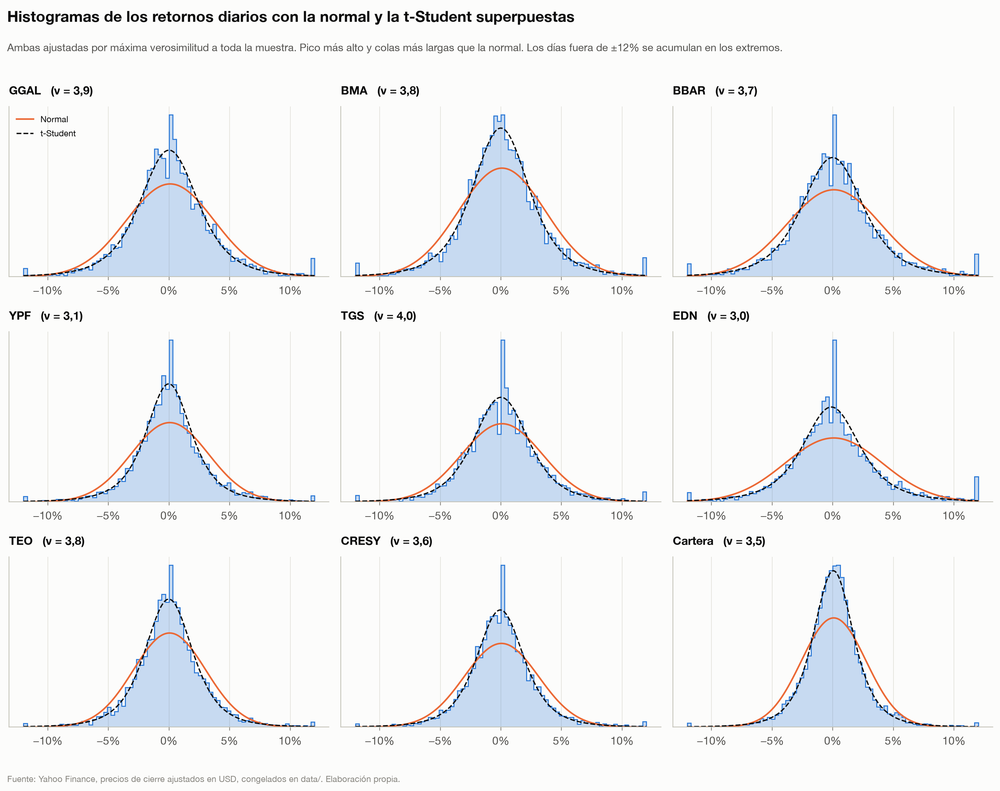

**Figura 6. Histogramas con la normal y la t-Student superpuestas.** Las dos distribuciones se ajustan por máxima verosimilitud a toda la muestra. En todos los paneles se repite el patrón que define a una distribución leptocúrtica: **más altura en el centro, menos en los "hombros"** (aproximadamente entre 1 y 2 desvíos) **y más en las colas** que la normal naranja. La t-Student (línea punteada) sigue el centro y los hombros casi a la perfección.

**Tabla 6. Parámetros de la t-Student ajustada por máxima verosimilitud.**

|               | ν (grados de libertad)   | Escala   |
|:--------------|:-------------------------|:---------|
| GGAL          | 3,88                     | 2,50%    |
| BMA           | 3,76                     | 2,45%    |
| BBAR          | 3,73                     | 2,64%    |
| YPF           | 3,11                     | 1,98%    |
| TGS           | 3,99                     | 2,35%    |
| EDN           | 3,02                     | 2,50%    |
| TEO           | 3,78                     | 2,06%    |
| CRESY         | 3,62                     | 2,04%    |
| Cartera       | 3,50                     | 1,74%    |
| S&P 500 (SPY) | 2,47                     | 0,67%    |

**Lectura.** Los ADRs tienen ν entre 3,0 (EDN) y 4,0 (TGS). Esto importa por dos razones:

1. Con ν ≤ 4, la t no tiene cuarto momento finito: su curtosis "poblacional" es infinita (Recuadro 5). Por eso las curtosis muestrales de la Tabla 1 son tan grandes e inestables: dependen de unos pocos días.
2. Con ν > 2, la varianza sí existe, así que tiene sentido hablar de volatilidad y usar modelos que la pronostiquen.

Que el SPY dé ν = 2,5 no significa que sea más riesgoso que los ADRs. Significa que, **en relación con su propio desvío**, sus días extremos (octubre de 2008, marzo de 2020) son más raros y más lejanos: su riesgo está más concentrado en pocos episodios.

### Gráficos QQ

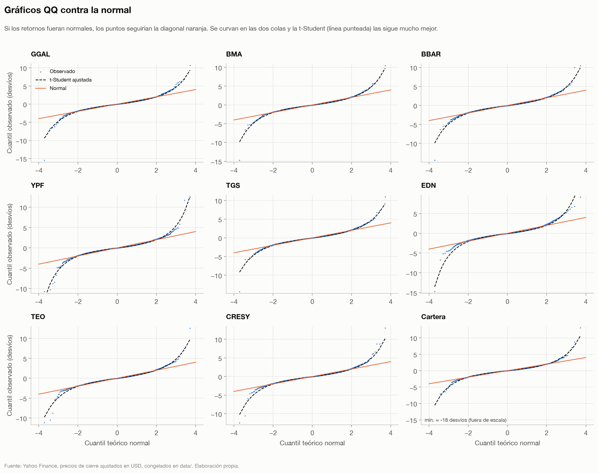

**Figura 7. Gráficos QQ contra la normal.** Cada punto compara un cuantil observado, en desvíos estándar, con el que tendría una normal. Los puntos siguen la diagonal entre −2 y +2 desvíos y se despegan en **las dos** colas: hasta −15 desvíos en los bancos y −18 en la cartera (las PASO). La curva de la t ajustada sigue esa forma en "S" mucho mejor que la recta. Es la justificación gráfica de los modelos con colas gruesas del estudio (MC t-Student, GARCH-t y EVT).

### Distribución de frecuencias de la cartera

**Tabla 3. Distribución de frecuencias del retorno diario de la cartera.** Los intervalos son cerrados a izquierda. La última columna es la probabilidad del intervalo bajo una normal con la misma media y desvío.

| Intervalo    | Frec. absoluta   | Frec. relativa   | Frec. acumulada   | Frec. rel. acumulada   | Esperada si fuera normal   |
|:-------------|:-----------------|:-----------------|:------------------|:-----------------------|:---------------------------|
| menor a -10% | 10               | 0,20%            | 10                | 0,20%                  | 0,01%                      |
| [-10%, -5%)  | 105              | 2,14%            | 115               | 2,34%                  | 2,85%                      |
| [-5%, -4%)   | 92               | 1,87%            | 207               | 4,22%                  | 3,48%                      |
| [-4%, -3%)   | 205              | 4,18%            | 412               | 8,39%                  | 6,12%                      |
| [-3%, -2%)   | 354              | 7,21%            | 766               | 15,60%                 | 9,38%                      |
| [-2%, -1%)   | 649              | 13,22%           | 1.415             | 28,82%                 | 12,51%                     |
| [-1%, 0%)    | 968              | 19,71%           | 2.383             | 48,53%                 | 14,52%                     |
| [0%, 1%)     | 1.051            | 21,41%           | 3.434             | 69,94%                 | 14,68%                     |
| [1%, 2%)     | 655              | 13,34%           | 4.089             | 83,28%                 | 12,91%                     |
| [2%, 3%)     | 368              | 7,49%            | 4.457             | 90,77%                 | 9,89%                      |
| [3%, 4%)     | 181              | 3,69%            | 4.638             | 94,46%                 | 6,59%                      |
| [4%, 5%)     | 114              | 2,32%            | 4.752             | 96,78%                 | 3,82%                      |
| [5%, 10%)    | 140              | 2,85%            | 4.892             | 99,63%                 | 3,24%                      |
| 10% o más    | 18               | 0,37%            | 4.910             | 100,00%                | 0,01%                      |

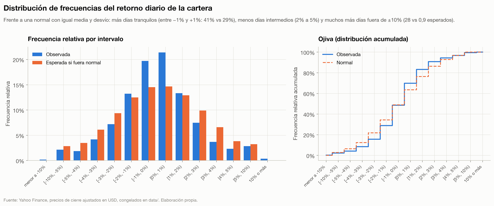

**Figura 8. Frecuencias relativas y ojiva.** La tabla cuantifica lo que muestran los histogramas:

- El **41%** de los días la cartera se mueve menos de ±1%. Una normal predeciría 29%.
- Entre 2% y 5%, en cualquiera de las dos direcciones, hay **menos** días que en la normal. Por ejemplo, en [3%, 4%) cae el 3,7% de los días, contra 6,6% esperado.
- Fuera de ±10% hay **28 días** observados contra **0,9** esperados: 30 veces más.

Por eso la ojiva observada (azul) es más empinada en el centro que la normal. En la cola izquierda casi coincide con ella: la frecuencia acumulada hasta −5% es 2,3%, contra 2,9% de la normal. Lo que cambia es *qué tan lejos* llegan las pérdidas una vez cruzado ese umbral.

Para el VaR, la consecuencia es concreta: una normal puede acertar **aproximadamente** el cuantil del 1%, pero subestima por órdenes de magnitud **cuánto** se pierde más allá de él. Eso es lo que mide el Expected Shortfall, y es la razón por la que Basilea III lo adoptó como medida principal.

### Frecuencias por activo y días extremos

**Tabla 4. Frecuencia relativa por intervalo, por activo.**

|               | menor a -10%   | [-10%, -5%)   | [-5%, -2%)   | [-2%, 0%)   | [0%, 2%)   | [2%, 5%)   | [5%, 10%)   | 10% o más   | Días a más de 3 desvíos   |
|:--------------|:---------------|:--------------|:-------------|:------------|:-----------|:-----------|:------------|:------------|:--------------------------|
| GGAL          | 0,6%           | 4,9%          | 17,3%        | 26,3%       | 27,0%      | 17,3%      | 5,5%        | 1,2%        | 1,3%                      |
| BMA           | 0,5%           | 4,9%          | 17,5%        | 27,7%       | 26,1%      | 16,8%      | 5,5%        | 1,0%        | 1,3%                      |
| BBAR          | 0,8%           | 5,5%          | 17,9%        | 25,2%       | 26,1%      | 16,9%      | 6,3%        | 1,3%        | 1,3%                      |
| YPF           | 0,5%           | 3,3%          | 15,1%        | 30,5%       | 31,1%      | 14,5%      | 4,5%        | 0,5%        | 1,2%                      |
| TGS           | 0,5%           | 3,9%          | 17,2%        | 26,2%       | 29,9%      | 16,5%      | 5,0%        | 0,8%        | 1,2%                      |
| EDN           | 0,9%           | 5,5%          | 18,0%        | 25,9%       | 26,1%      | 15,3%      | 6,5%        | 1,8%        | 1,5%                      |
| TEO           | 0,2%           | 3,6%          | 15,7%        | 30,3%       | 30,3%      | 15,6%      | 3,7%        | 0,5%        | 1,2%                      |
| CRESY         | 0,2%           | 3,2%          | 16,1%        | 30,2%       | 30,8%      | 15,1%      | 3,8%        | 0,6%        | 1,2%                      |
| Cartera       | 0,2%           | 2,1%          | 13,3%        | 32,9%       | 34,7%      | 13,5%      | 2,9%        | 0,4%        | 1,0%                      |
| S&P 500 (SPY) | 0,0%           | 0,3%          | 3,9%         | 40,6%       | 51,9%      | 2,9%       | 0,3%        | 0,1%        | 1,7%                      |

**Lectura.** Con la misma grilla de intervalos, las distribuciones de los ADRs son **más anchas que la de la cartera** y mucho más que la del S&P 500. Entre el 0,2% (TEO, CRESY) y el 0,9% (EDN) de los días cae más de 10%, y entre el 0,5% y el 1,8% sube más de 10%. En el S&P 500, en cambio, el 92,5% de los días se mueve menos de ±2%. Los bancos y EDN tienen las colas más pobladas; YPF, TEO y CRESY, las más delgadas entre los argentinos.

**Tabla 5. Días extremos: cantidad observada a más de k desvíos de la media vs la esperada bajo normalidad.**

|                          | Más de 3 desvíos   | Más de 4 desvíos   | Más de 5 desvíos   |
|:-------------------------|:-------------------|:-------------------|:-------------------|
| GGAL                     | 62                 | 23                 | 14                 |
| BMA                      | 63                 | 25                 | 11                 |
| BBAR                     | 65                 | 19                 | 11                 |
| YPF                      | 57                 | 24                 | 9                  |
| TGS                      | 60                 | 22                 | 9                  |
| EDN                      | 75                 | 29                 | 14                 |
| TEO                      | 57                 | 19                 | 9                  |
| CRESY                    | 58                 | 20                 | 9                  |
| Cartera                  | 50                 | 20                 | 12                 |
| S&P 500 (SPY)            | 82                 | 37                 | 19                 |
| Esperado si fuera normal | 13                 | 0,311              | 0,003              |

**Lectura.** Con 4.910 días, una normal predice 13 días a más de 3 desvíos, 0,3 a más de 4 y 0,003 a más de 5 (es decir, un solo día cada 350 muestras como esta). Cada ADR tiene entre 9 y 14 días a más de 5 desvíos. Con una normal, un evento así no debería ocurrir nunca en la vida de un inversor; acá ocurre cada uno o dos años.

### Diagramas de caja

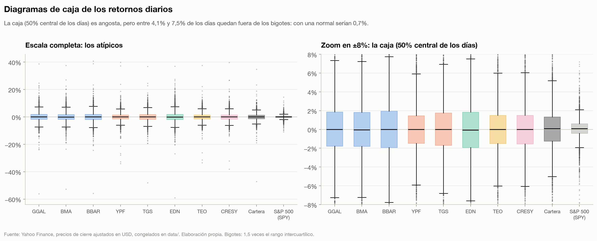

**Figura 9. Diagramas de caja.** A la izquierda, en escala completa, dominan los atípicos: los puntos del 12/08/2019 por debajo de −30% y las subas de octubre de 2025 por encima de +30%. A la derecha, el zoom en ±8% muestra la caja. El 50% central de los días cae aproximadamente entre −1,9% y +1,9% en los bancos y EDN, y entre −1,5% y +1,8% en el resto. En los ADRs, entre el 4,1% y el 5,8% de los días queda **fuera de los bigotes** (1,5 rangos intercuartílicos), cuando con una normal sería 0,7%. El S&P 500 tiene la caja más angosta (de −0,4% a +0,6%) y, en proporción, todavía más atípicos (7,5%): colas gruesas tiene cualquier mercado. Lo propio de Argentina es su **escala**: un atípico del SPY es un −5%; uno de un ADR, un −30%.

---

## 2.9 Los días extremos

**Tabla 23. Los 10 peores días de la cartera**, con el retorno del S&P 500 el mismo día.

| #   | Fecha      | Retorno   | S&P 500 ese día   | Evento                                                          |
|:----|:-----------|:----------|:------------------|:----------------------------------------------------------------|
| 1   | 12/08/2019 | -47,1%    | -1,2%             | PASO 2019                                                       |
| 2   | 08/09/2025 | -18,9%    | 0,2%              | Elección bonaerense 2025                                        |
| 3   | 09/03/2020 | -17,2%    | -7,8%             | COVID-19 y guerra de precios del petróleo                       |
| 4   | 21/10/2008 | -17,1%    | -3,0%             | Anuncio de la estatización de las AFJP                          |
| 5   | 18/03/2020 | -15,6%    | -5,1%             | COVID-19                                                        |
| 6   | 22/10/2008 | -14,1%    | -5,4%             | Estatización de las AFJP (segundo día)                          |
| 7   | 16/03/2020 | -13,8%    | -10,9%            | COVID-19                                                        |
| 8   | 12/03/2020 | -12,2%    | -9,6%             | COVID-19                                                        |
| 9   | 30/08/2018 | -11,4%    | -0,4%             | Corrida cambiaria de agosto de 2018                             |
| 10  | 19/08/2019 | -11,3%    | 1,2%              | Semana posterior a las PASO (renuncia del ministro de Hacienda) |

**Tabla 24. Los 10 mejores días de la cartera.**

| #   | Fecha      | Retorno   | S&P 500 ese día   | Evento                                              |
|:----|:-----------|:----------|:------------------|:----------------------------------------------------|
| 1   | 27/10/2025 | 34,9%     | 1,2%              | Legislativas 2025                                   |
| 2   | 20/11/2023 | 23,5%     | 0,8%              | Balotaje 2023                                       |
| 3   | 06/07/2020 | 18,9%     | 1,5%              | Nueva oferta de reestructuración de la deuda        |
| 4   | 31/08/2018 | 16,5%     | 0,0%              | Rebote tras la corrida cambiaria                    |
| 5   | 22/09/2025 | 15,3%     | 0,5%              | Anuncio de apoyo del Tesoro de EE. UU.              |
| 6   | 10/03/2020 | 12,5%     | 5,2%              | COVID-19 (rebote)                                   |
| 7   | 30/07/2014 | 12,3%     | 0,0%              | Vence el plazo con los holdouts (default selectivo) |
| 8   | 26/10/2015 | 12,2%     | -0,2%             | Primera vuelta presidencial 2015                    |
| 9   | 09/10/2025 | 12,2%     | -0,3%             | Tesoro de EE. UU.: compra de pesos y swap           |
| 10  | 24/11/2023 | 10,9%     | 0,1%              | Semana posterior al balotaje                        |

**Lectura.** La columna del S&P 500 permite separar los shocks **globales** de los **locales**:

- **Peores días.** Los cuatro días de marzo de 2020 son globales: el S&P 500 también cayó entre 5% y 11%. Los dos días de octubre de 2008 son mixtos: crisis global más estatización de las AFJP. En cambio, las PASO (−47,1% contra −1,2% del S&P 500), la elección bonaerense (−18,9% contra +0,2%), la corrida de agosto de 2018 (−11,4% contra −0,4%) y la semana posterior a las PASO (−11,3% contra +1,2%) son shocks **puramente argentinos**.
- **Mejores días.** Nueve de los diez son locales. Cuatro son elecciones o su semana siguiente (legislativas 2025, balotaje 2023 y la semana posterior, primera vuelta de 2015). Los otros cinco son decisiones de política o de financiamiento: la oferta de deuda de 2020, el rebote tras la corrida de 2018, los dos anuncios del Tesoro de EE. UU. de 2025 y el día del default selectivo de 2014. Solo el rebote del 10/03/2020 acompaña al mercado global.
- **Simetría.** Hay tantos saltos políticos hacia arriba como hacia abajo, lo que explica la asimetría cercana a cero de los ADRs. Para un modelo de riesgo, esto significa que la cola derecha también es gruesa: un inversor **corto** en ADRs argentinos enfrenta el mismo problema que uno largo.

---

## 2.10 Análisis por activo

Esta sección describe cada activo por separado: qué es la empresa, qué riesgos específicos tiene, cómo se comportaron sus retornos y cuáles fueron sus días y episodios extremos. La Tabla 25 resume todos los indicadores; después viene una ficha por activo.

**Tabla 25. Ficha por activo.**

| Indicador                   | GGAL       | BMA        | BBAR       | YPF            | TGS            | EDN          | TEO                | CRESY               | Cartera    |
|:----------------------------|:-----------|:-----------|:-----------|:---------------|:---------------|:-------------|:-------------------|:--------------------|:-----------|
| Sector                      | Bancos     | Bancos     | Bancos     | Petróleo y gas | Petróleo y gas | Electricidad | Telecomunicaciones | Agro e inmobiliario | Cartera    |
| Ruedas                      | 4.910      | 4.910      | 4.910      | 4.910          | 4.910          | 4.910        | 4.910              | 4.910               | 4.910      |
| Retorno medio diario        | 0,096%     | 0,088%     | 0,092%     | 0,063%         | 0,097%         | 0,080%       | 0,046%             | 0,045%              | 0,076%     |
| Desvío diario               | 3,63%      | 3,58%      | 3,87%      | 3,19%          | 3,35%          | 4,02%        | 2,99%              | 3,06%               | 2,67%      |
| Volatilidad anual           | 57,6%      | 56,8%      | 61,4%      | 50,6%          | 53,1%          | 63,7%        | 47,4%              | 48,6%               | 42,4%      |
| Crecimiento anual compuesto | 7,6%       | 5,9%       | 4,2%       | 3,0%           | 10,7%          | -0,6%        | 0,3%               | -0,6%               | 10,4%      |
| Peor día                    | -56,1%     | -52,7%     | -55,9%     | -34,1%         | -48,0%         | -59,0%       | -33,4%             | -38,1%              | -47,1%     |
| Fecha del peor día          | 12/08/2019 | 12/08/2019 | 12/08/2019 | 12/08/2019     | 12/08/2019     | 12/08/2019   | 12/08/2019         | 12/08/2019          | 12/08/2019 |
| Mejor día                   | 38,7%      | 37,6%      | 40,8%      | 39,9%          | 36,8%          | 36,9%        | 37,5%              | 39,8%               | 34,9%      |
| Fecha del mejor día         | 27/10/2025 | 27/10/2025 | 27/10/2025 | 20/11/2023     | 27/10/2025     | 27/10/2025   | 27/10/2025         | 06/07/2020          | 27/10/2025 |
| Percentil 1                 | -8,21%     | -8,29%     | -9,22%     | -7,79%         | -7,98%         | -9,40%       | -7,11%             | -7,07%              | -6,37%     |
| Percentil 99                | 10,53%     | 10,07%     | 10,86%     | 8,39%          | 9,47%          | 12,73%       | 8,22%              | 8,80%               | 6,94%      |
| Asimetría                   | -0,25      | -0,13      | 0,02       | 0,20           | -0,06          | 0,09         | 0,10               | 0,43                | -0,50      |
| Curtosis en exceso          | 18,3       | 15,7       | 16,0       | 18,5           | 14,8           | 15,3         | 14,2               | 17,7                | 30,4       |
| ν de la t                   | 3,9        | 3,8        | 3,7        | 3,1            | 4,0            | 3,0          | 3,8                | 3,6                 | 3,5        |
| Máxima caída                | -91,7%     | -91,7%     | -91,5%     | -94,5%         | -83,1%         | -95,5%       | -85,9%             | -89,4%              | -86,3%     |
| Máximo previo a la caída    | 18/01/2018 | 23/10/2017 | 16/01/2018 | 05/01/2011     | 05/07/2007     | 26/01/2018   | 24/01/2018         | 07/11/2017          | 18/01/2018 |
| Mínimo de la caída          | 27/04/2020 | 21/07/2022 | 14/07/2022 | 18/03/2020     | 27/10/2008     | 24/04/2020   | 26/04/2021         | 23/03/2020          | 19/03/2020 |
| Recuperó el máximo          | 18/11/2024 | 16/12/2024 | 16/12/2024 | 18/05/2026     | 09/03/2015     | no           | no                 | no                  | 19/09/2024 |
| Días sin cambio de precio   | 1,9%       | 0,6%       | 2,7%       | 1,9%           | 4,4%           | 3,9%         | 1,6%               | 2,1%                | 0,0%       |
| Correlación con la cartera  | 0,87       | 0,87       | 0,85       | 0,70           | 0,73           | 0,73         | 0,72               | 0,68                | 1,00       |
| Correlación con el S&P 500  | 0,40       | 0,38       | 0,36       | 0,30           | 0,27           | 0,27         | 0,35               | 0,39                | 0,44       |
| Beta respecto del S&P 500   | 1,18       | 1,10       | 1,13       | 0,77           | 0,72           | 0,88         | 0,84               | 0,95                | 0,95       |

*Beta respecto del S&P 500: cuánto se mueve el activo, en promedio, por cada 1% del S&P 500. Días sin cambio de precio: proporción de ruedas con retorno exactamente cero.*

**Lectura comparada.**

- **Los bancos (GGAL, BMA, BBAR) son el núcleo de la cartera.** Son los más correlacionados con ella (0,85 a 0,87) y con el S&P 500 (0,36 a 0,40), los únicos con beta mayor a 1, y los tres perdieron más de 91% en el mismo episodio de 2018-2022.
- **YPF es el activo más "propio".** Tiene la curtosis más alta (18,5), la t con colas más gruesas entre los ADRs después de EDN (ν = 3,1), una beta baja (0,77; solo TGS tiene menos) y la caída más larga: 15 años bajo su máximo de enero de 2011.
- **EDN es el más riesgoso por casi cualquier medida.** Tiene la mayor volatilidad (63,7%), el peor día (−59%), la mayor caída (−95,5%), las colas más gruesas (ν = 3,0) y un crecimiento compuesto negativo.
- **TGS es el mejor negocio de la muestra.** Creció 10,7% anual compuesto, lo mismo que el S&P 500, y tuvo la menor caída máxima entre los ADRs (−83%). Pero es el menos líquido: 4,4% de días sin cambio de precio.
- **Ningún ADR escapó a las PASO.** Los ocho tuvieron su peor día el 12/08/2019, y los ocho tuvieron su mejor día en una elección (siete) o, en el caso de CRESY, en la oferta de deuda de 2020.

### 2.10.1 GGAL · Grupo Financiero Galicia (bancos)

**La empresa.** Grupo Financiero Galicia es el holding del Banco Galicia, uno de los mayores bancos privados de capital nacional, con negocios de tarjetas, seguros y administración de fondos. En 2024 compró las operaciones argentinas de HSBC. Como todo banco argentino, su balance depende del soberano: tiene títulos públicos y deuda del Banco Central, y sus depósitos y su crédito dependen de la estabilidad macroeconómica y cambiaria. Por eso un banco argentino es, en buena medida, **una apuesta apalancada al riesgo país**.

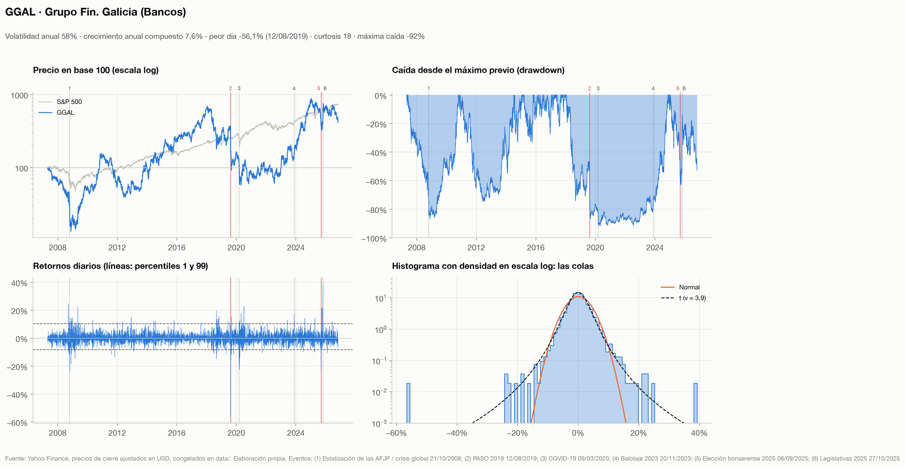

**Figura 10. GGAL: precio, drawdown, retornos e histograma.** Hay cuatro lecturas:

- **Volatilidad y sensibilidad global.** Tiene 57,6% de volatilidad anual y la **beta más alta de la cartera (1,18)**: es el ADR que más amplifica los movimientos del S&P 500.
- **Ciclos extremos.** Ganó 155% en 2009, 166% en 2010 y 289% en 2024, y perdió 70% en 2008 y 61% en 2011.
- **La caída más profunda.** Va del 18/01/2018 al 27/04/2020 (**−91,7%**) y tardó hasta el 18/11/2024 en recuperar el máximo: casi siete años.
- **Colas gruesas en las dos direcciones.** El histograma en escala logarítmica (abajo a la derecha) muestra días de −56% y +39% donde la normal no tiene probabilidad visible.

**Peores y mejores días de GGAL.**

**Peores 5 días**

| #   | Fecha      | Retorno   | S&P 500 ese día   | Evento                                 |
|:----|:-----------|:----------|:------------------|:---------------------------------------|
| 1   | 12/08/2019 | -56,1%    | -1,2%             | PASO 2019                              |
| 2   | 21/10/2008 | -23,9%    | -3,0%             | Anuncio de la estatización de las AFJP |
| 3   | 08/09/2025 | -23,6%    | 0,2%              | Elección bonaerense 2025               |
| 4   | 16/03/2020 | -22,5%    | -10,9%            | COVID-19                               |
| 5   | 18/03/2020 | -20,4%    | -5,1%             | COVID-19                               |

**Mejores 5 días**

| #   | Fecha      | Retorno   | S&P 500 ese día   | Evento                                                             |
|:----|:-----------|:----------|:------------------|:-------------------------------------------------------------------|
| 1   | 27/10/2025 | 38,7%     | 1,2%              | Legislativas 2025                                                  |
| 2   | 19/09/2008 | 24,7%     | 4,0%              | Plan de rescate de EE. UU. (TARP) y prohibición de ventas en corto |
| 3   | 06/07/2020 | 22,8%     | 1,5%              | Nueva oferta de reestructuración de la deuda                       |
| 4   | 08/05/2009 | 22,6%     | 2,3%              | –                                                                  |
| 5   | 09/10/2025 | 21,7%     | -0,3%             | Tesoro de EE. UU.: compra de pesos y swap                          |

**Episodios de caída de GGAL.**

| #   | Máximo previo   | Mínimo     | Caída   | Ruedas hasta el mínimo   | Recuperación   | Ruedas bajo el máximo   |
|:----|:----------------|:-----------|:--------|:-------------------------|:---------------|:------------------------|
| 1   | 18/01/2018      | 27/04/2020 | -91,7%  | 571                      | 18/11/2024     | 1.720                   |
| 2   | 01/06/2007      | 19/11/2008 | -86,6%  | 372                      | 20/10/2010     | 854                     |
| 3   | 06/12/2010      | 11/06/2012 | -74,6%  | 381                      | 09/07/2014     | 902                     |

<details>
<summary><b>Tabla de frecuencias completa de GGAL</b></summary>

| Intervalo    | Frec. absoluta   | Frec. relativa   | Frec. acumulada   | Frec. rel. acumulada   | Esperada si fuera normal   |
|:-------------|:-----------------|:-----------------|:------------------|:-----------------------|:---------------------------|
| menor a -10% | 28               | 0,57%            | 28                | 0,57%                  | 0,27%                      |
| [-10%, -5%)  | 240              | 4,89%            | 268               | 5,46%                  | 7,73%                      |
| [-5%, -4%)   | 161              | 3,28%            | 429               | 8,74%                  | 4,94%                      |
| [-4%, -3%)   | 272              | 5,54%            | 701               | 14,28%                 | 6,73%                      |
| [-3%, -2%)   | 416              | 8,47%            | 1.117             | 22,75%                 | 8,50%                      |
| [-2%, -1%)   | 620              | 12,63%           | 1.737             | 35,38%                 | 9,96%                      |
| [-1%, 0%)    | 672              | 13,69%           | 2.409             | 49,06%                 | 10,82%                     |
| [0%, 1%)     | 770              | 15,68%           | 3.179             | 64,75%                 | 10,90%                     |
| [1%, 2%)     | 556              | 11,32%           | 3.735             | 76,07%                 | 10,18%                     |
| [2%, 3%)     | 401              | 8,17%            | 4.136             | 84,24%                 | 8,81%                      |
| [3%, 4%)     | 270              | 5,50%            | 4.406             | 89,74%                 | 7,08%                      |
| [4%, 5%)     | 179              | 3,65%            | 4.585             | 93,38%                 | 5,27%                      |
| [5%, 10%)    | 268              | 5,46%            | 4.853             | 98,84%                 | 8,51%                      |
| 10% o más    | 57               | 1,16%            | 4.910             | 100,00%                | 0,32%                      |

</details>

**Interpretación.** De sus cinco peores días, tres son locales (PASO, AFJP y elección bonaerense) y dos son del COVID. Entre sus mejores días hay uno global (el plan de rescate TARP de septiembre de 2008, con el S&P 500 +4,0%), pero el resto son políticos (legislativas 2025) o de financiamiento (oferta de deuda de 2020 y compra de pesos del Tesoro de EE. UU.). El 22,6% del 08/05/2009 no tiene un evento público claro identificado y se deja sin etiqueta. GGAL es el activo que mejor representa el riesgo de la cartera: su correlación con ella es 0,87.

### 2.10.2 BMA · Banco Macro (bancos)

**La empresa.** Banco Macro es uno de los mayores bancos privados del país, con fuerte presencia en el interior: es agente financiero de varias provincias. En 2023 compró Itaú Argentina. Su exposición al soberano es similar a la de Galicia, con un componente adicional de riesgo provincial.

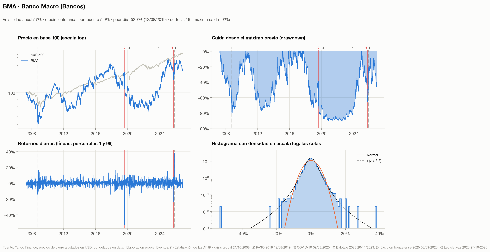

**Figura 11. BMA.**

- **Perfil parecido a GGAL.** Tiene 56,8% de volatilidad, curtosis de 15,7 y peor día de −52,7% en las PASO.
- **El más líquido.** Tiene el menor porcentaje de días sin cambio de precio de la cartera (0,6%).
- **Un descenso largo.** Su gran caída empezó antes que la de los otros bancos (máximo el 23/10/2017) y tocó fondo más tarde (21/07/2022): **1.193 ruedas de descenso**, casi cinco años de caída continua hasta −91,7%. Recuperó el máximo el 16/12/2024.

**Peores y mejores días de BMA.**

**Peores 5 días**

| #   | Fecha      | Retorno   | S&P 500 ese día   | Evento                                    |
|:----|:-----------|:----------|:------------------|:------------------------------------------|
| 1   | 12/08/2019 | -52,7%    | -1,2%             | PASO 2019                                 |
| 2   | 08/09/2025 | -23,5%    | 0,2%              | Elección bonaerense 2025                  |
| 3   | 09/03/2020 | -19,0%    | -7,8%             | COVID-19 y guerra de precios del petróleo |
| 4   | 16/03/2020 | -18,6%    | -10,9%            | COVID-19                                  |
| 5   | 22/10/2008 | -18,5%    | -5,4%             | Estatización de las AFJP (segundo día)    |

**Mejores 5 días**

| #   | Fecha      | Retorno   | S&P 500 ese día   | Evento                                       |
|:----|:-----------|:----------|:------------------|:---------------------------------------------|
| 1   | 27/10/2025 | 37,6%     | 1,2%              | Legislativas 2025                            |
| 2   | 31/08/2018 | 27,0%     | 0,0%              | Rebote tras la corrida cambiaria             |
| 3   | 06/07/2020 | 22,5%     | 1,5%              | Nueva oferta de reestructuración de la deuda |
| 4   | 26/10/2015 | 20,4%     | -0,2%             | Primera vuelta presidencial 2015             |
| 5   | 22/09/2025 | 20,2%     | 0,5%              | Anuncio de apoyo del Tesoro de EE. UU.       |

**Episodios de caída de BMA.**

| #   | Máximo previo   | Mínimo     | Caída   | Ruedas hasta el mínimo   | Recuperación   | Ruedas bajo el máximo   |
|:----|:----------------|:-----------|:--------|:-------------------------|:---------------|:------------------------|
| 1   | 23/10/2017      | 21/07/2022 | -91,7%  | 1.193                    | 16/12/2024     | 1.798                   |
| 2   | 21/05/2007      | 29/10/2008 | -81,2%  | 365                      | 20/07/2010     | 797                     |
| 3   | 10/12/2010      | 24/07/2012 | -77,5%  | 407                      | 17/02/2015     | 1.051                   |

<details>
<summary><b>Tabla de frecuencias completa de BMA</b></summary>

| Intervalo    | Frec. absoluta   | Frec. relativa   | Frec. acumulada   | Frec. rel. acumulada   | Esperada si fuera normal   |
|:-------------|:-----------------|:-----------------|:------------------|:-----------------------|:---------------------------|
| menor a -10% | 26               | 0,53%            | 26                | 0,53%                  | 0,24%                      |
| [-10%, -5%)  | 239              | 4,87%            | 265               | 5,40%                  | 7,52%                      |
| [-5%, -4%)   | 145              | 2,95%            | 410               | 8,35%                  | 4,91%                      |
| [-4%, -3%)   | 261              | 5,32%            | 671               | 13,67%                 | 6,74%                      |
| [-3%, -2%)   | 454              | 9,25%            | 1.125             | 22,91%                 | 8,57%                      |
| [-2%, -1%)   | 602              | 12,26%           | 1.727             | 35,17%                 | 10,07%                     |
| [-1%, 0%)    | 757              | 15,42%           | 2.484             | 50,59%                 | 10,96%                     |
| [0%, 1%)     | 701              | 14,28%           | 3.185             | 64,87%                 | 11,03%                     |
| [1%, 2%)     | 581              | 11,83%           | 3.766             | 76,70%                 | 10,28%                     |
| [2%, 3%)     | 387              | 7,88%            | 4.153             | 84,58%                 | 8,86%                      |
| [3%, 4%)     | 258              | 5,25%            | 4.411             | 89,84%                 | 7,07%                      |
| [4%, 5%)     | 178              | 3,63%            | 4.589             | 93,46%                 | 5,22%                      |
| [5%, 10%)    | 270              | 5,50%            | 4.859             | 98,96%                 | 8,23%                      |
| 10% o más    | 51               | 1,04%            | 4.910             | 100,00%                | 0,28%                      |

</details>

**Interpretación.** Los cinco mejores días de BMA son **todos locales**: legislativas 2025, rebote tras la corrida de 2018, oferta de deuda de 2020, primera vuelta de 2015 y apoyo del Tesoro de EE. UU. El S&P 500 se movió a lo sumo 1,5% en cada uno. Es el ADR cuyo lado positivo depende más claramente de la política argentina.

### 2.10.3 BBAR · BBVA Argentina (bancos)

**La empresa.** BBVA Argentina, ex BBVA Francés, es la filial local del banco español BBVA. Tiene el mismo tipo de exposición soberana que los otros bancos, con un accionista controlante extranjero.

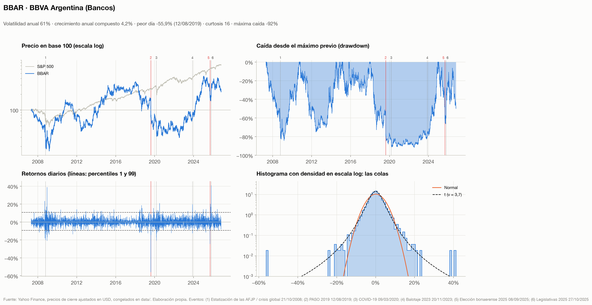

**Figura 12. BBAR.**

- **El banco más volátil.** Tiene 61,4% de volatilidad anual, el mejor día de la cartera (+40,8% en las legislativas 2025) y el mayor retorno anual de la muestra (+316% en 2024).
- **Mismo episodio de caída que BMA.** Del 16/01/2018 al 14/07/2022 perdió 91,5%, y recuperó el máximo el 16/12/2024.
- **Una anomalía en los datos.** El 17/12/2008 subió 38,9% y el 18/12/2008 cayó 20,9%, sin un evento público identificado y con el S&P 500 casi quieto. Es probable que se trate de un precio poco representativo (baja liquidez en plena crisis) o de un ajuste de datos. Se conserva porque está en la fuente, pero se marca como sospechoso en las limitaciones.

**Peores y mejores días de BBAR.**

**Peores 5 días**

| #   | Fecha      | Retorno   | S&P 500 ese día   | Evento                                 |
|:----|:-----------|:----------|:------------------|:---------------------------------------|
| 1   | 12/08/2019 | -55,9%    | -1,2%             | PASO 2019                              |
| 2   | 08/09/2025 | -24,4%    | 0,2%              | Elección bonaerense 2025               |
| 3   | 18/12/2008 | -20,9%    | -1,9%             | –                                      |
| 4   | 12/03/2020 | -20,7%    | -9,6%             | COVID-19                               |
| 5   | 21/10/2008 | -20,1%    | -3,0%             | Anuncio de la estatización de las AFJP |

**Mejores 5 días**

| #   | Fecha      | Retorno   | S&P 500 ese día   | Evento                                                             |
|:----|:-----------|:----------|:------------------|:-------------------------------------------------------------------|
| 1   | 27/10/2025 | 40,8%     | 1,2%              | Legislativas 2025                                                  |
| 2   | 17/12/2008 | 38,9%     | -1,0%             | –                                                                  |
| 3   | 19/09/2008 | 23,4%     | 4,0%              | Plan de rescate de EE. UU. (TARP) y prohibición de ventas en corto |
| 4   | 06/07/2020 | 20,9%     | 1,5%              | Nueva oferta de reestructuración de la deuda                       |
| 5   | 22/09/2025 | 20,3%     | 0,5%              | Anuncio de apoyo del Tesoro de EE. UU.                             |

**Episodios de caída de BBAR.**

| #   | Máximo previo   | Mínimo     | Caída   | Ruedas hasta el mínimo   | Recuperación   | Ruedas bajo el máximo   |
|:----|:----------------|:-----------|:--------|:-------------------------|:---------------|:------------------------|
| 1   | 16/01/2018      | 14/07/2022 | -91,5%  | 1.131                    | 16/12/2024     | 1.741                   |
| 2   | 21/05/2007      | 05/03/2009 | -84,2%  | 451                      | 20/09/2010     | 840                     |
| 3   | 05/11/2010      | 15/06/2012 | -75,0%  | 405                      | 03/07/2014     | 919                     |

<details>
<summary><b>Tabla de frecuencias completa de BBAR</b></summary>

| Intervalo    | Frec. absoluta   | Frec. relativa   | Frec. acumulada   | Frec. rel. acumulada   | Esperada si fuera normal   |
|:-------------|:-----------------|:-----------------|:------------------|:-----------------------|:---------------------------|
| menor a -10% | 37               | 0,75%            | 37                | 0,75%                  | 0,46%                      |
| [-10%, -5%)  | 270              | 5,50%            | 307               | 6,25%                  | 8,96%                      |
| [-5%, -4%)   | 177              | 3,60%            | 484               | 9,86%                  | 5,10%                      |
| [-4%, -3%)   | 281              | 5,72%            | 765               | 15,58%                 | 6,70%                      |
| [-3%, -2%)   | 423              | 8,62%            | 1.188             | 24,20%                 | 8,22%                      |
| [-2%, -1%)   | 590              | 12,02%           | 1.778             | 36,21%                 | 9,45%                      |
| [-1%, 0%)    | 647              | 13,18%           | 2.425             | 49,39%                 | 10,16%                     |
| [0%, 1%)     | 741              | 15,09%           | 3.166             | 64,48%                 | 10,22%                     |
| [1%, 2%)     | 540              | 11,00%           | 3.706             | 75,48%                 | 9,62%                      |
| [2%, 3%)     | 371              | 7,56%            | 4.077             | 83,03%                 | 8,48%                      |
| [3%, 4%)     | 266              | 5,42%            | 4.343             | 88,45%                 | 6,99%                      |
| [4%, 5%)     | 195              | 3,97%            | 4.538             | 92,42%                 | 5,39%                      |
| [5%, 10%)    | 307              | 6,25%            | 4.845             | 98,68%                 | 9,72%                      |
| 10% o más    | 65               | 1,32%            | 4.910             | 100,00%                | 0,52%                      |

</details>

**Interpretación.** BBAR tiene la mayor frecuencia de días por debajo de −10% entre los bancos (0,8%; T4) y la mayor proporción de días sin cambio de precio (2,7%). Es el banco con más riesgo de cola y menos liquidez de los tres.

### 2.10.4 YPF · YPF (petróleo y gas)

**La empresa.** YPF es la mayor petrolera del país y el principal operador de Vaca Muerta. Desde la expropiación de 2012, el Estado nacional controla el 51% de sus acciones. Su valor depende de tres cosas: el precio internacional del petróleo, la política local de precios de los combustibles y el riesgo de intervención estatal. Por la expropiación, además, la República enfrenta un juicio en Nueva York por la forma en que se hizo.

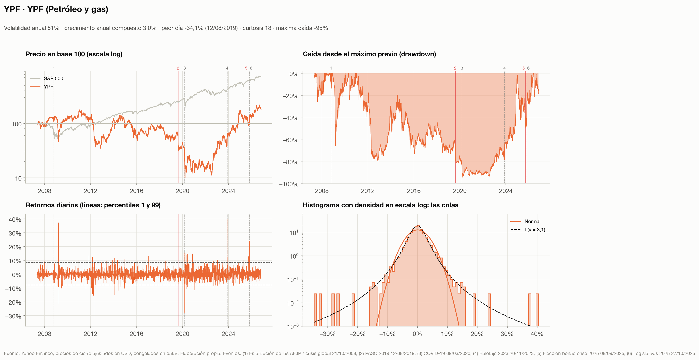

**Figura 13. YPF.**

- **El activo con historia propia.** Ganó 26% en 2008, cuando todos los demás ADRs perdían más de 50%, y perdió 57% en 2012, el año de la expropiación, mientras los bancos quedaban casi sin cambios.
- **La caída más larga de la muestra.** Fue del 05/01/2011 al 18/03/2020 (**−94,5%**, después de 2.314 ruedas de descenso) y recién recuperó el máximo el 18/05/2026: **más de 15 años bajo el máximo previo**.
- **Las colas más gruesas en términos relativos.** Tiene la curtosis más alta de los ADRs (18,5) con una volatilidad intermedia (50,6%): sus retornos son "tranquilos con saltos".

**Peores y mejores días de YPF.**

**Peores 5 días**

| #   | Fecha      | Retorno   | S&P 500 ese día   | Evento                                                |
|:----|:-----------|:----------|:------------------|:------------------------------------------------------|
| 1   | 12/08/2019 | -34,1%    | -1,2%             | PASO 2019                                             |
| 2   | 18/04/2012 | -32,7%    | -0,3%             | Semana de la expropiación de YPF (anuncio 16/04/2012) |
| 3   | 09/03/2020 | -27,9%    | -7,8%             | COVID-19 y guerra de precios del petróleo             |
| 4   | 18/03/2020 | -26,8%    | -5,1%             | COVID-19                                              |
| 5   | 05/03/2009 | -21,3%    | -4,1%             | Crisis financiera global                              |

**Mejores 5 días**

| #   | Fecha      | Retorno   | S&P 500 ese día   | Evento            |
|:----|:-----------|:----------|:------------------|:------------------|
| 1   | 20/11/2023 | 39,9%     | 0,8%              | Balotaje 2023     |
| 2   | 19/03/2009 | 37,3%     | -1,2%             | –                 |
| 3   | 27/10/2025 | 23,8%     | 1,2%              | Legislativas 2025 |
| 4   | 19/03/2020 | 18,7%     | 0,2%              | COVID-19 (rebote) |
| 5   | 10/03/2020 | 15,6%     | 5,2%              | COVID-19 (rebote) |

**Episodios de caída de YPF.**

| #   | Máximo previo   | Mínimo     | Caída   | Ruedas hasta el mínimo   | Recuperación   | Ruedas bajo el máximo   |
|:----|:----------------|:-----------|:--------|:-------------------------|:---------------|:------------------------|
| 1   | 05/01/2011      | 18/03/2020 | -94,5%  | 2.314                    | 18/05/2026     | 3.863                   |
| 2   | 05/12/2008      | 10/03/2009 | -65,7%  | 63                       | 04/01/2010     | 270                     |
| 3   | 20/06/2007      | 17/08/2007 | -25,9%  | 41                       | 12/03/2008     | 183                     |

<details>
<summary><b>Tabla de frecuencias completa de YPF</b></summary>

| Intervalo    | Frec. absoluta   | Frec. relativa   | Frec. acumulada   | Frec. rel. acumulada   | Esperada si fuera normal   |
|:-------------|:-----------------|:-----------------|:------------------|:-----------------------|:---------------------------|
| menor a -10% | 24               | 0,49%            | 24                | 0,49%                  | 0,08%                      |
| [-10%, -5%)  | 162              | 3,30%            | 186               | 3,79%                  | 5,52%                      |
| [-5%, -4%)   | 116              | 2,36%            | 302               | 6,15%                  | 4,51%                      |
| [-4%, -3%)   | 221              | 4,50%            | 523               | 10,65%                 | 6,71%                      |
| [-3%, -2%)   | 406              | 8,27%            | 929               | 18,92%                 | 9,05%                      |
| [-2%, -1%)   | 639              | 13,01%           | 1.568             | 31,93%                 | 11,07%                     |
| [-1%, 0%)    | 857              | 17,45%           | 2.425             | 49,39%                 | 12,28%                     |
| [0%, 1%)     | 974              | 19,84%           | 3.399             | 69,23%                 | 12,36%                     |
| [1%, 2%)     | 551              | 11,22%           | 3.950             | 80,45%                 | 11,27%                     |
| [2%, 3%)     | 349              | 7,11%            | 4.299             | 87,56%                 | 9,33%                      |
| [3%, 4%)     | 233              | 4,75%            | 4.532             | 92,30%                 | 7,00%                      |
| [4%, 5%)     | 129              | 2,63%            | 4.661             | 94,93%                 | 4,77%                      |
| [5%, 10%)    | 223              | 4,54%            | 4.884             | 99,47%                 | 5,97%                      |
| 10% o más    | 26               | 0,53%            | 4.910             | 100,00%                | 0,09%                      |

</details>

**Interpretación.** Es el único ADR con un shock propio de la empresa entre sus peores días: el **18/04/2012** (−32,7%), en la semana de la expropiación, con el S&P 500 casi quieto. Su mejor día es el balotaje de 2023 (+39,9%), cuando el mercado anticipó un cambio en la política de precios de los combustibles. El +37,3% del 19/03/2009 no tiene un evento público claro identificado. Tiene una de las betas más bajas (0,77) y una de las menores correlaciones con la cartera (0,70): es el activo que **más diversifica** dentro de la cartera, aunque en las PASO cayó igual.

### 2.10.5 TGS · Transportadora de Gas del Sur (petróleo y gas)

**La empresa.** TGS transporta gas natural por gasoductos del sur del país, un negocio regulado con tarifas fijadas por el Estado. También procesa gas y produce líquidos (etano, propano y butano) que se venden a precios internacionales, y desarrolla infraestructura de *midstream* en Vaca Muerta. Combina, entonces, un negocio regulado en pesos con uno no regulado en dólares.

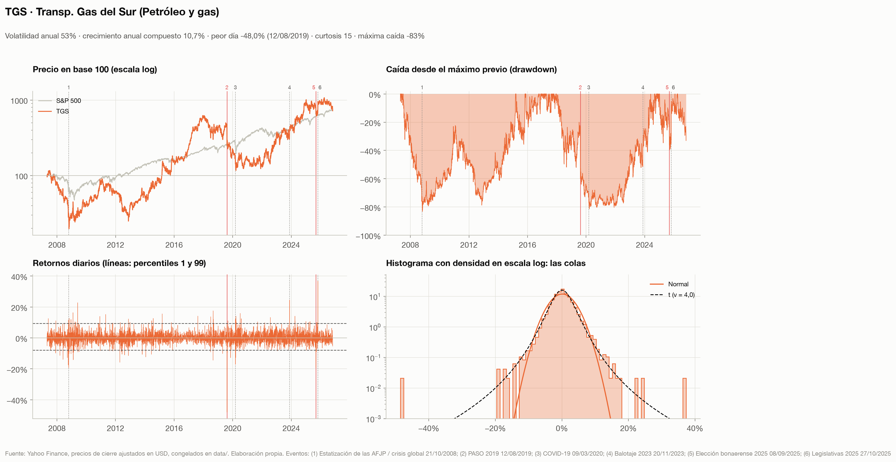

**Figura 14. TGS.**

- **El mejor desempeño de la muestra.** Creció 10,7% anual compuesto, igual que el S&P 500, con la menor caída máxima entre los ADRs (−83,1%) y las colas menos gruesas (ν = 4,0; curtosis 14,8).
- **Recuperaciones lentas.** Su peor episodio de caída fue en la crisis de 2008 y tardó hasta marzo de 2015 en recuperar el máximo: 1.932 ruedas. El segundo episodio (2017-2020, −81,3%) se recuperó en septiembre de 2024.
- **El menos líquido.** Tiene 4,4% de días sin cambio de precio, el máximo de la cartera. Es parte de la explicación de su pico en cero en el histograma.

**Peores y mejores días de TGS.**

**Peores 5 días**

| #   | Fecha      | Retorno   | S&P 500 ese día   | Evento                                    |
|:----|:-----------|:----------|:------------------|:------------------------------------------|
| 1   | 12/08/2019 | -48,0%    | -1,2%             | PASO 2019                                 |
| 2   | 08/09/2025 | -19,3%    | 0,2%              | Elección bonaerense 2025                  |
| 3   | 21/10/2008 | -19,3%    | -3,0%             | Anuncio de la estatización de las AFJP    |
| 4   | 09/10/2008 | -17,6%    | -7,0%             | Crisis financiera global                  |
| 5   | 09/03/2020 | -17,1%    | -7,8%             | COVID-19 y guerra de precios del petróleo |

**Mejores 5 días**

| #   | Fecha      | Retorno   | S&P 500 ese día   | Evento                           |
|:----|:-----------|:----------|:------------------|:---------------------------------|
| 1   | 27/10/2025 | 36,8%     | 1,2%              | Legislativas 2025                |
| 2   | 20/11/2023 | 24,6%     | 0,8%              | Balotaje 2023                    |
| 3   | 01/06/2009 | 22,8%     | 2,4%              | –                                |
| 4   | 31/08/2018 | 17,6%     | 0,0%              | Rebote tras la corrida cambiaria |
| 5   | 03/02/2009 | 16,4%     | 1,4%              | –                                |

**Episodios de caída de TGS.**

| #   | Máximo previo   | Mínimo     | Caída   | Ruedas hasta el mínimo   | Recuperación   | Ruedas bajo el máximo   |
|:----|:----------------|:-----------|:--------|:-------------------------|:---------------|:------------------------|
| 1   | 05/07/2007      | 27/10/2008 | -83,1%  | 332                      | 09/03/2015     | 1.932                   |
| 2   | 20/12/2017      | 23/03/2020 | -81,3%  | 565                      | 05/09/2024     | 1.686                   |
| 3   | 07/01/2025      | 18/09/2025 | -39,5%  | 174                      | 27/01/2026     | 263                     |

<details>
<summary><b>Tabla de frecuencias completa de TGS</b></summary>

| Intervalo    | Frec. absoluta   | Frec. relativa   | Frec. acumulada   | Frec. rel. acumulada   | Esperada si fuera normal   |
|:-------------|:-----------------|:-----------------|:------------------|:-----------------------|:---------------------------|
| menor a -10% | 26               | 0,53%            | 26                | 0,53%                  | 0,13%                      |
| [-10%, -5%)  | 191              | 3,89%            | 217               | 4,42%                  | 6,26%                      |
| [-5%, -4%)   | 141              | 2,87%            | 358               | 7,29%                  | 4,66%                      |
| [-4%, -3%)   | 299              | 6,09%            | 657               | 13,38%                 | 6,69%                      |
| [-3%, -2%)   | 405              | 8,25%            | 1.062             | 21,63%                 | 8,81%                      |
| [-2%, -1%)   | 597              | 12,16%           | 1.659             | 33,79%                 | 10,61%                     |
| [-1%, 0%)    | 687              | 13,99%           | 2.346             | 47,78%                 | 11,69%                     |
| [0%, 1%)     | 887              | 18,07%           | 3.233             | 65,85%                 | 11,79%                     |
| [1%, 2%)     | 582              | 11,85%           | 3.815             | 77,70%                 | 10,88%                     |
| [2%, 3%)     | 380              | 7,74%            | 4.195             | 85,44%                 | 9,19%                      |
| [3%, 4%)     | 265              | 5,40%            | 4.460             | 90,84%                 | 7,11%                      |
| [4%, 5%)     | 164              | 3,34%            | 4.624             | 94,18%                 | 5,03%                      |
| [5%, 10%)    | 246              | 5,01%            | 4.870             | 99,19%                 | 6,99%                      |
| 10% o más    | 40               | 0,81%            | 4.910             | 100,00%                | 0,15%                      |

</details>

**Interpretación.** TGS ganó 166% en 2022 y 146% en 2017, años de expectativas de mejores tarifas y de desarrollo de Vaca Muerta. Tiene la menor correlación con el S&P 500 de la cartera (0,27, igual que EDN): su riesgo es casi enteramente local y regulatorio.

### 2.10.6 EDN · Edenor (electricidad)

**La empresa.** Edenor es la mayor distribuidora de electricidad del país por cantidad de clientes: atiende el norte del Gran Buenos Aires y parte de la Ciudad de Buenos Aires. Es un negocio **completamente regulado**, con tarifas fijadas por el Estado nacional, y su rentabilidad depende de las decisiones tarifarias de cada gobierno. Hubo largos períodos de tarifas congeladas en contextos de alta inflación.

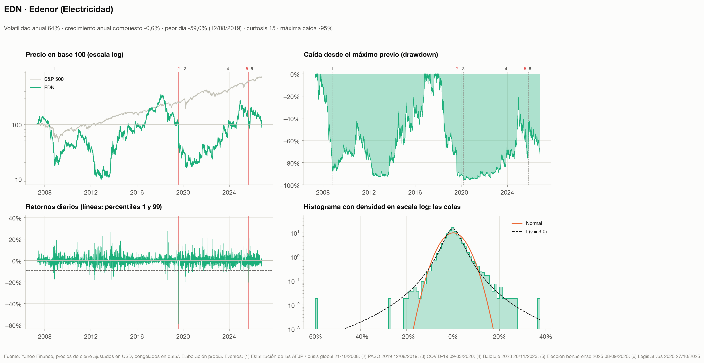

**Figura 15. EDN.**

- **El activo más riesgoso de la cartera.** Tiene la mayor volatilidad (63,7%), el peor día (−59,0% en las PASO), los percentiles extremos más anchos (P1 −9,4% y P99 +12,7%), las colas más gruesas (ν = 3,0) y las dos caídas más profundas de la muestra: −93,1% entre 2007 y 2012 y **−95,5%** entre 2018 y 2020. Esta última sigue sin recuperarse.
- **Crecimiento compuesto negativo** (−0,6% anual) pese a una media aritmética de +20%. Es el caso extremo del costo de la volatilidad de la Tabla 2.
- **Años extremos en las dos direcciones:** −82% en 2008, −77% en 2019, +159% en 2013 y +142% en 2023.

**Peores y mejores días de EDN.**

**Peores 5 días**

| #   | Fecha      | Retorno   | S&P 500 ese día   | Evento                                    |
|:----|:-----------|:----------|:------------------|:------------------------------------------|
| 1   | 12/08/2019 | -59,0%    | -1,2%             | PASO 2019                                 |
| 2   | 21/10/2008 | -26,9%    | -3,0%             | Anuncio de la estatización de las AFJP    |
| 3   | 08/09/2025 | -20,5%    | 0,2%              | Elección bonaerense 2025                  |
| 4   | 09/03/2020 | -20,1%    | -7,8%             | COVID-19 y guerra de precios del petróleo |
| 5   | 30/08/2018 | -18,2%    | -0,4%             | Corrida cambiaria de agosto de 2018       |

**Mejores 5 días**

| #   | Fecha      | Retorno   | S&P 500 ese día   | Evento                           |
|:----|:-----------|:----------|:------------------|:---------------------------------|
| 1   | 27/10/2025 | 36,9%     | 1,2%              | Legislativas 2025                |
| 2   | 31/08/2018 | 27,6%     | 0,0%              | Rebote tras la corrida cambiaria |
| 3   | 23/09/2013 | 26,5%     | -0,5%             | –                                |
| 4   | 20/11/2023 | 24,6%     | 0,8%              | Balotaje 2023                    |
| 5   | 07/05/2012 | 23,7%     | 0,1%              | –                                |

**Episodios de caída de EDN.**

| #   | Máximo previo   | Mínimo     | Caída   | Ruedas hasta el mínimo   | Recuperación   | Ruedas bajo el máximo   |
|:----|:----------------|:-----------|:--------|:-------------------------|:---------------|:------------------------|
| 1   | 26/01/2018      | 24/04/2020 | -95,5%  | 564                      | sin recuperar  | 2.203                   |
| 2   | 02/11/2007      | 19/11/2012 | -93,1%  | 1.270                    | 25/10/2016     | 2.260                   |
| 3   | 13/07/2007      | 16/08/2007 | -23,0%  | 24                       | 08/10/2007     | 60                      |

<details>
<summary><b>Tabla de frecuencias completa de EDN</b></summary>

| Intervalo    | Frec. absoluta   | Frec. relativa   | Frec. acumulada   | Frec. rel. acumulada   | Esperada si fuera normal   |
|:-------------|:-----------------|:-----------------|:------------------|:-----------------------|:---------------------------|
| menor a -10% | 43               | 0,88%            | 43                | 0,88%                  | 0,60%                      |
| [-10%, -5%)  | 269              | 5,48%            | 312               | 6,35%                  | 9,69%                      |
| [-5%, -4%)   | 182              | 3,71%            | 494               | 10,06%                 | 5,19%                      |
| [-4%, -3%)   | 286              | 5,82%            | 780               | 15,89%                 | 6,67%                      |
| [-3%, -2%)   | 418              | 8,51%            | 1.198             | 24,40%                 | 8,07%                      |
| [-2%, -1%)   | 566              | 11,53%           | 1.764             | 35,93%                 | 9,18%                      |
| [-1%, 0%)    | 708              | 14,42%           | 2.472             | 50,35%                 | 9,81%                      |
| [0%, 1%)     | 808              | 16,46%           | 3.280             | 66,80%                 | 9,86%                      |
| [1%, 2%)     | 472              | 9,61%            | 3.752             | 76,42%                 | 9,31%                      |
| [2%, 3%)     | 352              | 7,17%            | 4.104             | 83,58%                 | 8,27%                      |
| [3%, 4%)     | 248              | 5,05%            | 4.352             | 88,64%                 | 6,91%                      |
| [4%, 5%)     | 153              | 3,12%            | 4.505             | 91,75%                 | 5,42%                      |
| [5%, 10%)    | 317              | 6,46%            | 4.822             | 98,21%                 | 10,35%                     |
| 10% o más    | 88               | 1,79%            | 4.910             | 100,00%                | 0,67%                      |

</details>

**Interpretación.** EDN es el activo más expuesto al **riesgo regulatorio**. Sus grandes movimientos coinciden con cambios en las expectativas sobre la política tarifaria: es probable que la caída de 2019 tras las PASO reflejara el temor a un congelamiento de tarifas, y las subas de 2023 y 2025, lo contrario. Dos de sus mejores días (23/09/2013 y 07/05/2012) no tienen un evento público claro identificado. Pueden responder a noticias regulatorias específicas de la empresa y se dejan sin etiqueta.

### 2.10.7 TEO · Telecom Argentina (telecomunicaciones)

**La empresa.** Telecom Argentina ofrece telefonía fija y móvil (Personal), internet y televisión por cable desde su fusión con Cablevisión (2017-2018). En 2025 compró las operaciones argentinas de Telefónica (Movistar). Sus tarifas estuvieron reguladas en distintos períodos.

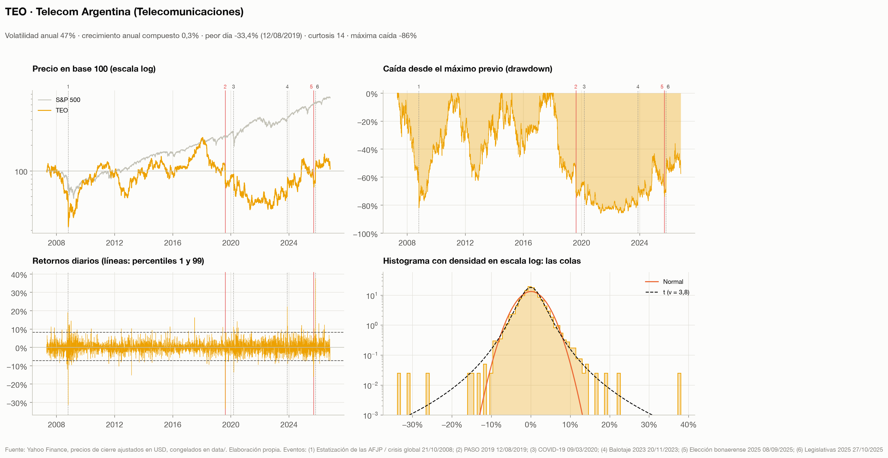

**Figura 16. TEO.**

- **El ADR menos volátil.** Tiene 47,4% de volatilidad anual, la menor curtosis (14,2) y un peor día "moderado" (−33,4%).
- **Uno de los más golpeados por la estatización de las AFJP.** Perdió 26,2% y 31,4% el 21 y el 22/10/2008. Es su segundo y tercer peor día, casi tan malos como las PASO.
- **Una caída sin recuperar.** Perdió 85,9% entre el 24/01/2018 y el 26/04/2021, y todavía no recuperó el máximo. Su crecimiento compuesto en 19 años es prácticamente cero (0,3% anual).

**Peores y mejores días de TEO.**

**Peores 5 días**

| #   | Fecha      | Retorno   | S&P 500 ese día   | Evento                                 |
|:----|:-----------|:----------|:------------------|:---------------------------------------|
| 1   | 12/08/2019 | -33,4%    | -1,2%             | PASO 2019                              |
| 2   | 22/10/2008 | -31,4%    | -5,4%             | Estatización de las AFJP (segundo día) |
| 3   | 21/10/2008 | -26,2%    | -3,0%             | Anuncio de la estatización de las AFJP |
| 4   | 08/09/2025 | -16,1%    | 0,2%              | Elección bonaerense 2025               |
| 5   | 28/02/2013 | -15,2%    | -0,2%             | –                                      |

**Mejores 5 días**

| #   | Fecha      | Retorno   | S&P 500 ese día   | Evento                                              |
|:----|:-----------|:----------|:------------------|:----------------------------------------------------|
| 1   | 27/10/2025 | 37,5%     | 1,2%              | Legislativas 2025                                   |
| 2   | 20/11/2023 | 22,3%     | 0,8%              | Balotaje 2023                                       |
| 3   | 13/10/2008 | 19,0%     | 14,5%             | Rebote global tras los rescates bancarios en Europa |
| 4   | 03/07/2017 | 16,3%     | 0,2%              | –                                                   |
| 5   | 02/01/2009 | 14,5%     | 3,0%              | –                                                   |

**Episodios de caída de TEO.**

| #   | Máximo previo   | Mínimo     | Caída   | Ruedas hasta el mínimo   | Recuperación   | Ruedas bajo el máximo   |
|:----|:----------------|:-----------|:--------|:-------------------------|:---------------|:------------------------|
| 1   | 24/01/2018      | 26/04/2021 | -85,9%  | 818                      | sin recuperar  | 2.205                   |
| 2   | 31/05/2007      | 24/10/2008 | -81,9%  | 355                      | 18/01/2011     | 916                     |
| 3   | 01/07/2011      | 21/11/2012 | -62,5%  | 350                      | 23/06/2014     | 747                     |

<details>
<summary><b>Tabla de frecuencias completa de TEO</b></summary>

| Intervalo    | Frec. absoluta   | Frec. relativa   | Frec. acumulada   | Frec. rel. acumulada   | Esperada si fuera normal   |
|:-------------|:-----------------|:-----------------|:------------------|:-----------------------|:---------------------------|
| menor a -10% | 9                | 0,18%            | 9                 | 0,18%                  | 0,04%                      |
| [-10%, -5%)  | 179              | 3,65%            | 188               | 3,83%                  | 4,52%                      |
| [-5%, -4%)   | 116              | 2,36%            | 304               | 6,19%                  | 4,22%                      |
| [-4%, -3%)   | 231              | 4,70%            | 535               | 10,90%                 | 6,61%                      |
| [-3%, -2%)   | 426              | 8,68%            | 961               | 19,57%                 | 9,28%                      |
| [-2%, -1%)   | 606              | 12,34%           | 1.567             | 31,91%                 | 11,64%                     |
| [-1%, 0%)    | 880              | 17,92%           | 2.447             | 49,84%                 | 13,07%                     |
| [0%, 1%)     | 923              | 18,80%           | 3.370             | 68,64%                 | 13,14%                     |
| [1%, 2%)     | 564              | 11,49%           | 3.934             | 80,12%                 | 11,82%                     |
| [2%, 3%)     | 377              | 7,68%            | 4.311             | 87,80%                 | 9,51%                      |
| [3%, 4%)     | 246              | 5,01%            | 4.557             | 92,81%                 | 6,86%                      |
| [4%, 5%)     | 144              | 2,93%            | 4.701             | 95,74%                 | 4,42%                      |
| [5%, 10%)    | 184              | 3,75%            | 4.885             | 99,49%                 | 4,82%                      |
| 10% o más    | 25               | 0,51%            | 4.910             | 100,00%                | 0,04%                      |

</details>

**Interpretación.** El 13/10/2008 (+19,0%) es uno de los pocos días extremos de un ADR explicados por el mercado global: el S&P 500 subió 14,5% ese día, tras los rescates bancarios en Europa. Los días del 28/02/2013 (−15,2%) y del 03/07/2017 (+16,3%) no tienen un evento público claro identificado.

### 2.10.8 CRESY · Cresud (agro e inmobiliario)

**La empresa.** Cresud tiene y explota tierras agrícolas en Argentina y en la región (agricultura y ganadería), y controla a IRSA, la principal empresa inmobiliaria del país (centros comerciales, oficinas y hoteles). Su valor depende de los precios de las materias primas agrícolas, del valor en dólares de la tierra y de los inmuebles, y del riesgo país.

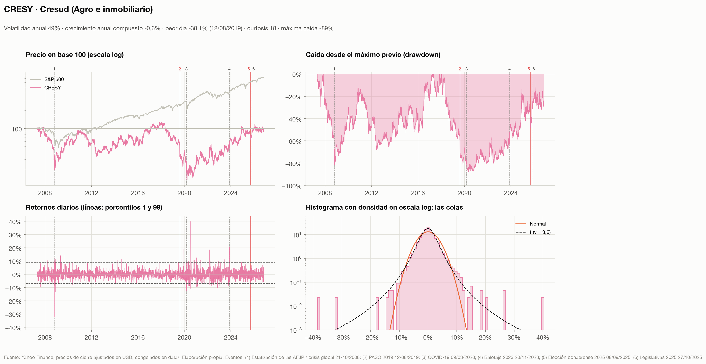

**Figura 17. CRESY.**

- **La asimetría más positiva de la cartera (+0,43).** Su cola derecha pesa más que la izquierda: su mejor día (+39,8%) supera en magnitud a su peor día (−38,1%).
- **La recuperación más lenta.** Perdió 81,3% en la crisis de 2008 y tardó **más de nueve años** (hasta febrero de 2017) en recuperar el máximo. Su segunda gran caída (−89,4%, 2017-2020) sigue sin recuperarse.
- **El menos correlacionado con la cartera (0,68)**, pero de los más correlacionados con el S&P 500 (0,39): es, junto con los bancos, el ADR más sensible al ciclo global.

**Peores y mejores días de CRESY.**

**Peores 5 días**

| #   | Fecha      | Retorno   | S&P 500 ese día   | Evento                                 |
|:----|:-----------|:----------|:------------------|:---------------------------------------|
| 1   | 12/08/2019 | -38,1%    | -1,2%             | PASO 2019                              |
| 2   | 22/10/2008 | -32,2%    | -5,4%             | Estatización de las AFJP (segundo día) |
| 3   | 18/03/2020 | -18,1%    | -5,1%             | COVID-19                               |
| 4   | 10/10/2008 | -14,0%    | -2,4%             | Crisis financiera global               |
| 5   | 20/11/2008 | -13,3%    | -7,4%             | Crisis financiera global               |

**Mejores 5 días**

| #   | Fecha      | Retorno   | S&P 500 ese día   | Evento                                       |
|:----|:-----------|:----------|:------------------|:---------------------------------------------|
| 1   | 06/07/2020 | 39,8%     | 1,5%              | Nueva oferta de reestructuración de la deuda |
| 2   | 27/10/2025 | 26,8%     | 1,2%              | Legislativas 2025                            |
| 3   | 25/03/2020 | 26,8%     | 1,5%              | COVID-19 (rebote)                            |
| 4   | 20/11/2023 | 20,3%     | 0,8%              | Balotaje 2023                                |
| 5   | 25/11/2019 | 18,9%     | 0,8%              | –                                            |

**Episodios de caída de CRESY.**

| #   | Máximo previo   | Mínimo     | Caída   | Ruedas hasta el mínimo   | Recuperación   | Ruedas bajo el máximo   |
|:----|:----------------|:-----------|:--------|:-------------------------|:---------------|:------------------------|
| 1   | 07/11/2017      | 23/03/2020 | -89,4%  | 595                      | sin recuperar  | 2.257                   |
| 2   | 29/10/2007      | 28/10/2008 | -81,3%  | 252                      | 13/02/2017     | 2.339                   |
| 3   | 27/04/2007      | 16/08/2007 | -29,7%  | 77                       | 29/10/2007     | 128                     |

<details>
<summary><b>Tabla de frecuencias completa de CRESY</b></summary>

| Intervalo    | Frec. absoluta   | Frec. relativa   | Frec. acumulada   | Frec. rel. acumulada   | Esperada si fuera normal   |
|:-------------|:-----------------|:-----------------|:------------------|:-----------------------|:---------------------------|
| menor a -10% | 12               | 0,24%            | 12                | 0,24%                  | 0,05%                      |
| [-10%, -5%)  | 158              | 3,22%            | 170               | 3,46%                  | 4,92%                      |
| [-5%, -4%)   | 127              | 2,59%            | 297               | 6,05%                  | 4,35%                      |
| [-4%, -3%)   | 252              | 5,13%            | 549               | 11,18%                 | 6,68%                      |
| [-3%, -2%)   | 410              | 8,35%            | 959               | 19,53%                 | 9,21%                      |
| [-2%, -1%)   | 658              | 13,40%           | 1.617             | 32,93%                 | 11,44%                     |
| [-1%, 0%)    | 824              | 16,78%           | 2.441             | 49,71%                 | 12,77%                     |
| [0%, 1%)     | 918              | 18,70%           | 3.359             | 68,41%                 | 12,83%                     |
| [1%, 2%)     | 593              | 12,08%           | 3.952             | 80,49%                 | 11,60%                     |
| [2%, 3%)     | 367              | 7,47%            | 4.319             | 87,96%                 | 9,43%                      |
| [3%, 4%)     | 248              | 5,05%            | 4.567             | 93,01%                 | 6,90%                      |
| [4%, 5%)     | 125              | 2,55%            | 4.692             | 95,56%                 | 4,54%                      |
| [5%, 10%)    | 187              | 3,81%            | 4.879             | 99,37%                 | 5,22%                      |
| 10% o más    | 31               | 0,63%            | 4.910             | 100,00%                | 0,06%                      |

</details>

**Interpretación.** Es el único ADR cuyo mejor día no fue una elección: fue la oferta de reestructuración de deuda del 06/07/2020 (+39,8%), un evento que redujo el riesgo país y benefició especialmente a una empresa con deuda en dólares. Junto con TEO, fue el ADR más golpeado el segundo día de la estatización de las AFJP (−32,2%). El 25/11/2019 (+18,9%) no tiene un evento público claro identificado.

### 2.10.9 La cartera equiponderada

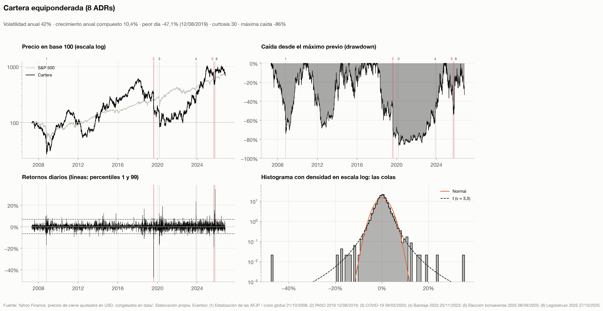

**Figura 18. La cartera.** La cartera resume lo que tienen en común los ocho activos. Tiene una volatilidad menor que cualquiera de ellos (42,4%) y un crecimiento compuesto (10,4%) mayor que el de todos salvo TGS. Pero hereda íntegro el riesgo político: el peor día (−47,1%), la caída máxima (−86,3%) y la curtosis (30,4) son de la misma escala que los de los activos individuales o peores. La diversificación entre ocho empresas argentinas **reduce el riesgo de empresa, pero no el riesgo país**.

---

## 2.11 Comparación entre activos y composición de la cartera

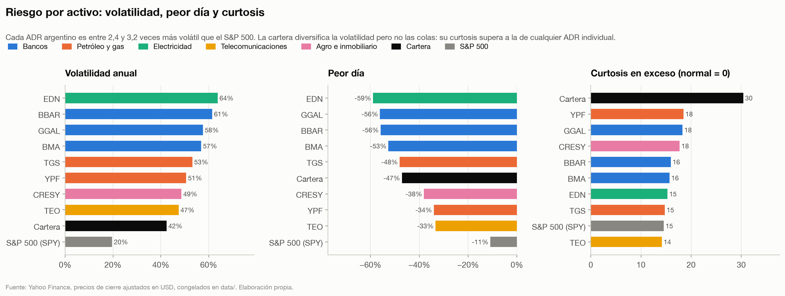

**Figura 19. Volatilidad anual, peor día y curtosis por activo.** El orden de los tres rankings **no coincide**. EDN es el más volátil y el que tuvo el peor día (−59%), pero no el de mayor curtosis. YPF tiene la curtosis más alta entre los ADRs (18,5) con una volatilidad intermedia. Por eso una sola medida de riesgo, como la volatilidad, no alcanza para ordenar estos activos.

El dato más importante es el de la **cartera**: es la de menor volatilidad entre los activos argentinos (42%), pero la de **mayor curtosis** (30). La diversificación reduce el desvío y concentra el riesgo en la cola.

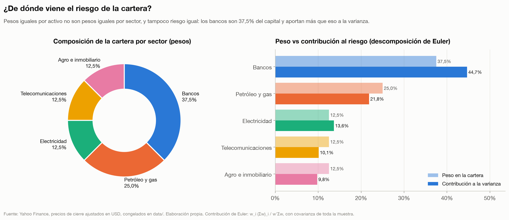

**Tabla 7. Composición y contribución al riesgo por sector.**

| Sector              | Peso   | Contribución al riesgo   |
|:--------------------|:-------|:-------------------------|
| Bancos              | 37,5%  | 44,7%                    |
| Petróleo y gas      | 25,0%  | 21,8%                    |
| Electricidad        | 12,5%  | 13,6%                    |
| Telecomunicaciones  | 12,5%  | 10,1%                    |
| Agro e inmobiliario | 12,5%  | 9,8%                     |

**Figura 20. ¿De dónde viene el riesgo?** Acá el gráfico de torta es honesto porque representa una **composición real**: los pesos de la cartera suman 100%. Los pesos iguales por activo resultan en **37,5% en bancos** (tres de los ocho ADRs), 25% en petróleo y gas, y 12,5% en cada uno de los otros tres sectores.

Para la contribución al riesgo se usan **barras y no otra torta**, porque lo que interesa es *comparar* dos cantidades por sector (peso y riesgo), y eso se lee mejor en barras alineadas. La contribución se calcula con la descomposición de Euler de la varianza, $RC_i = w_i (\Sigma w)_i / w'\Sigma w$, que suma exactamente 100%.

Los **bancos aportan 44,7% de la varianza con 37,5% del capital**: son volátiles y muy correlacionados entre sí (0,76 a 0,80). Telecomunicaciones y agro aportan menos que su peso. En la práctica, la cartera "equiponderada" es sobre todo una apuesta al sistema financiero argentino, y por esa vía, al soberano.

---

## 2.12 Dependencia entre activos

### Correlaciones de toda la muestra

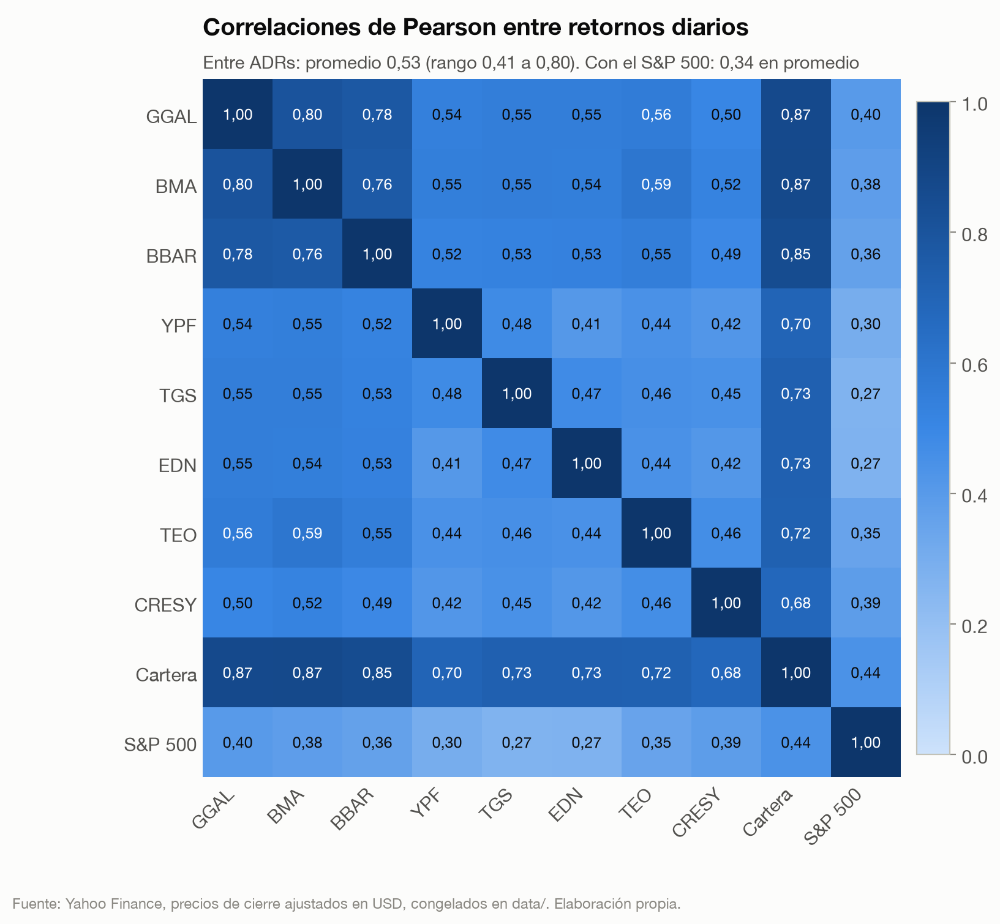

**Tabla 8. Matriz de correlaciones de Pearson entre retornos diarios.**

|               | GGAL   | BMA   | BBAR   | YPF   | TGS   | EDN   | TEO   | CRESY   | Cartera   | S&P 500 (SPY)   |
|:--------------|:-------|:------|:-------|:------|:------|:------|:------|:--------|:----------|:----------------|
| GGAL          | 1,00   | 0,80  | 0,78   | 0,54  | 0,55  | 0,55  | 0,56  | 0,50    | 0,87      | 0,40            |
| BMA           | 0,80   | 1,00  | 0,76   | 0,55  | 0,55  | 0,54  | 0,59  | 0,52    | 0,87      | 0,38            |
| BBAR          | 0,78   | 0,76  | 1,00   | 0,52  | 0,53  | 0,53  | 0,55  | 0,49    | 0,85      | 0,36            |
| YPF           | 0,54   | 0,55  | 0,52   | 1,00  | 0,48  | 0,41  | 0,44  | 0,42    | 0,70      | 0,30            |
| TGS           | 0,55   | 0,55  | 0,53   | 0,48  | 1,00  | 0,47  | 0,46  | 0,45    | 0,73      | 0,27            |
| EDN           | 0,55   | 0,54  | 0,53   | 0,41  | 0,47  | 1,00  | 0,44  | 0,42    | 0,73      | 0,27            |
| TEO           | 0,56   | 0,59  | 0,55   | 0,44  | 0,46  | 0,44  | 1,00  | 0,46    | 0,72      | 0,35            |
| CRESY         | 0,50   | 0,52  | 0,49   | 0,42  | 0,45  | 0,42  | 0,46  | 1,00    | 0,68      | 0,39            |
| Cartera       | 0,87   | 0,87  | 0,85   | 0,70  | 0,73  | 0,73  | 0,72  | 0,68    | 1,00      | 0,44            |
| S&P 500 (SPY) | 0,40   | 0,38  | 0,36   | 0,30  | 0,27  | 0,27  | 0,35  | 0,39    | 0,44      | 1,00            |

**Figura 21. Matriz de correlaciones.** Las correlaciones entre ADRs van de 0,41 a 0,80, con un promedio de 0,53. El bloque de los tres bancos (0,76 a 0,80) es el más correlacionado: en la práctica funcionan como un solo factor de riesgo. Con el S&P 500 las correlaciones son bajas (0,27 a 0,40): lo que mueve a estos activos es local.

### Correlaciones en el tiempo

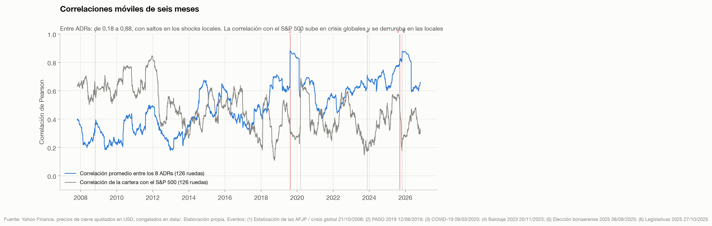

**Figura 22. Correlaciones móviles de seis meses.** La correlación de toda la muestra es un promedio de regímenes muy distintos:

- **Entre ADRs (azul)** va de 0,18 a 0,88. Fue baja entre 2009 y 2013 (0,2 a 0,4), cuando los factores propios de cada empresa pesaban más, y alta desde 2018 (0,6 a 0,88). Salta de golpe en los dos shocks políticos marcados en rojo: después de las PASO y de la elección bonaerense llega a 0,88. En esos días **todos los activos se convierten en uno solo**.
- **Con el S&P 500 (gris)** se comporta al revés. Sube en las crisis **globales** (0,7 a 0,85 en 2008-2012 y en marzo de 2020) y se **derrumba** en las crisis **locales**: baja a 0,3 después de las PASO y a 0,18 después de la elección bonaerense.

Para un modelo de riesgo, la consecuencia es que un shock argentino aumenta la correlación interna (la diversificación desaparece) y, al mismo tiempo, desacopla la cartera del mercado global (la cobertura con el S&P 500 deja de funcionar). El estudio principal lo mide de otra forma: la correlación promedio entre ADRs es 0,70 en el 20% de días más volátiles y 0,44 en el resto (figura `02_hechos_estilizados.png`).

### Dependencia en las colas

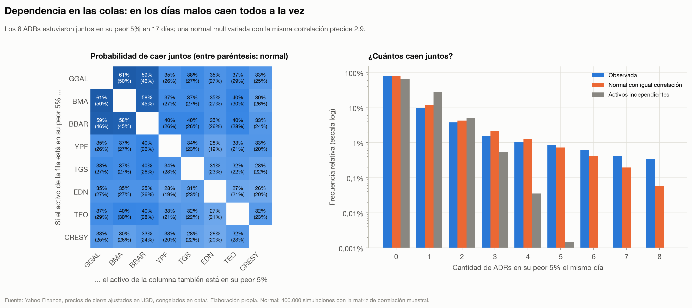

**Tabla 20. Coexcedencias observadas: probabilidad de que la columna esté en su peor 5% de días, dado que la fila lo está.**

|       | GGAL   | BMA   | BBAR   | YPF   | TGS   | EDN   | TEO   | CRESY   |
|:------|:-------|:------|:-------|:------|:------|:------|:------|:--------|
| GGAL  | 100%   | 61%   | 59%    | 35%   | 38%   | 35%   | 37%   | 33%     |
| BMA   | 61%    | 100%  | 58%    | 37%   | 37%   | 35%   | 40%   | 30%     |
| BBAR  | 59%    | 58%   | 100%   | 40%   | 40%   | 35%   | 40%   | 33%     |
| YPF   | 35%    | 37%   | 40%    | 100%  | 34%   | 28%   | 33%   | 33%     |
| TGS   | 38%    | 37%   | 40%    | 34%   | 100%  | 31%   | 32%   | 28%     |
| EDN   | 35%    | 35%   | 35%    | 28%   | 31%   | 100%  | 27%   | 26%     |
| TEO   | 37%    | 40%   | 40%    | 33%   | 32%   | 27%   | 100%  | 32%     |
| CRESY | 33%    | 30%   | 33%    | 33%   | 28%   | 26%   | 32%   | 100%    |

**Tabla 21. Las mismas coexcedencias bajo una normal multivariada con la misma matriz de correlación** (400.000 simulaciones).

|       | GGAL   | BMA   | BBAR   | YPF   | TGS   | EDN   | TEO   | CRESY   |
|:------|:-------|:------|:-------|:------|:------|:------|:------|:--------|
| GGAL  | 100%   | 50%   | 46%    | 26%   | 27%   | 27%   | 29%   | 25%     |
| BMA   | 50%    | 100%  | 45%    | 27%   | 27%   | 27%   | 30%   | 26%     |
| BBAR  | 46%    | 45%   | 100%   | 26%   | 26%   | 26%   | 28%   | 24%     |
| YPF   | 26%    | 27%   | 26%    | 100%  | 23%   | 19%   | 21%   | 20%     |
| TGS   | 27%    | 27%   | 26%    | 23%   | 100%  | 23%   | 22%   | 22%     |
| EDN   | 27%    | 27%   | 26%    | 19%   | 23%   | 100%  | 21%   | 20%     |
| TEO   | 29%    | 30%   | 28%    | 21%   | 22%   | 21%   | 100%  | 23%     |
| CRESY | 25%    | 26%   | 24%    | 20%   | 22%   | 20%   | 23%   | 100%    |

**Tabla 22. Distribución de frecuencias de la cantidad de ADRs que están en su peor 5% el mismo día.**

| ADRs en su peor 5% el mismo día   | Días observados   | Frecuencia observada   | Normal con igual correlación   | Activos independientes   |
|:----------------------------------|:------------------|:-----------------------|:-------------------------------|:-------------------------|
| 0                                 | 4.007             | 81,609%                | 79,036%                        | 66,342%                  |
| 1                                 | 476               | 9,695%                 | 11,844%                        | 27,933%                  |
| 2                                 | 186               | 3,788%                 | 4,262%                         | 5,146%                   |
| 3                                 | 78                | 1,589%                 | 2,186%                         | 0,542%                   |
| 4                                 | 52                | 1,059%                 | 1,273%                         | 0,036%                   |
| 5                                 | 43                | 0,876%                 | 0,731%                         | 0,002%                   |
| 6                                 | 30                | 0,611%                 | 0,412%                         | 0,000%                   |
| 7                                 | 21                | 0,428%                 | 0,197%                         | 0,000%                   |
| 8                                 | 17                | 0,346%                 | 0,059%                         | 0,000%                   |

**Figura 23. Dependencia en las colas.** Es el resultado más importante del capítulo para un modelo de VaR de cartera:

- **Las coexcedencias observadas superan sistemáticamente a las de la normal.** En promedio, si un ADR está en su peor 5%, otro también lo está el **37%** de las veces. Una normal con la misma correlación predice 27%, y con activos independientes sería 5%. Entre los tres bancos, la coexcedencia es 59% contra 47% de la normal.
- **Los días en que caen todos juntos son mucho más frecuentes de lo que permite la normal.** Hubo 17 días en que los ocho ADRs estuvieron a la vez en su peor 5%; la normal predice 2,9. Y hubo 111 días con al menos cinco ADRs en la cola, contra 69 de la normal.
- **En el centro de la distribución, la normal funciona razonablemente.** La frecuencia de 0, 1 o 2 activos en la cola es parecida a la normal. La diferencia está en el extremo derecho del gráfico: los días en que caen todos.

**Implicancia:** un Monte Carlo con normal multivariada, aunque use la correlación correcta, **subestima la probabilidad de que todos caigan juntos**. Por eso el modelo MC t-Student del estudio divide todo el vector normal por un único factor $\sqrt{\chi^2/\nu}$: así genera dependencia en las colas, que es justamente lo que estos datos muestran.

---

## 2.13 Volatilidad y VaR estimado en el tiempo

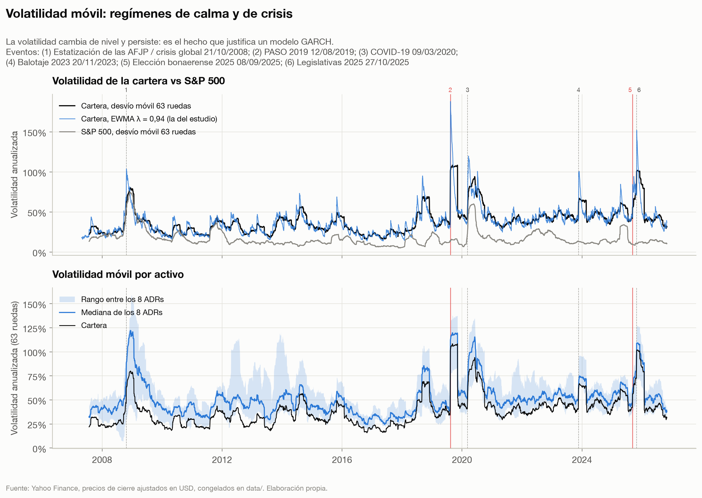

**Tabla 10. Volatilidad EWMA diaria de la cartera (λ = 0,94).**

|                                | N     | Media   | Mediana   | Desvío   | Mín.   | Máx.   | P5    | P95   |
|:-------------------------------|:------|:--------|:----------|:---------|:-------|:-------|:------|:------|
| Vol. EWMA diaria de la cartera | 4.890 | 2,42%   | 2,29%     | 1,14%    | 0,87%  | 11,84% | 1,21% | 4,69% |

**Figura 24. Volatilidad móvil.** Muestra dos regularidades que justifican un modelo de volatilidad condicional:

- **La volatilidad cambia de nivel.** La volatilidad diaria EWMA va de 0,87% en el día más tranquilo a 11,8% después de las PASO. Su P5 es 1,2% y su P95, 4,7%: un día de mercado agitado (P95) tiene casi cuatro veces el riesgo de uno tranquilo (P5). Cualquier VaR con volatilidad fija queda desalineado en los dos extremos a la vez.
- **La volatilidad persiste.** Después de cada shock tarda meses en volver a su nivel. La EWMA (azul) reacciona al día siguiente y decae de forma gradual. El desvío móvil de 63 ruedas (negro) reacciona de golpe y "olvida" de golpe 63 ruedas después: es el escalón que se ve en noviembre de 2019. Esa diferencia es la que separa en el backtest a los modelos con EWMA de la simulación histórica.

El panel inferior muestra que la volatilidad de la cartera (negro) está casi siempre por debajo de la mediana de los ADRs (azul), salvo en los picos de crisis, donde se le acerca: **la diversificación funciona en calma y se pierde en crisis**. El S&P 500 tiene sus propios picos (2008, 2020), pero no los argentinos (2019, 2025).

**Tabla 9. La cartera por período de gobierno.**

|                       | N     | Media anual   | Volatilidad anual   | Peor día   | Mejor día   | Curtosis exceso   |
|:----------------------|:------|:--------------|:--------------------|:-----------|:------------|:------------------|
| Kirchner (2007-2015)  | 2.172 | 16,5%         | 34,5%               | -17,1%     | 12,3%       | 5,4               |
| Macri (2015-2019)     | 1.006 | -1,0%         | 42,6%               | -47,1%     | 16,5%       | 95,9              |
| Fernández (2019-2023) | 1.007 | 31,8%         | 49,9%               | -17,2%     | 23,5%       | 6,0               |
| Milei (2023-2026)     | 725   | 37,2%         | 51,2%               | -18,9%     | 34,9%       | 20,2              |

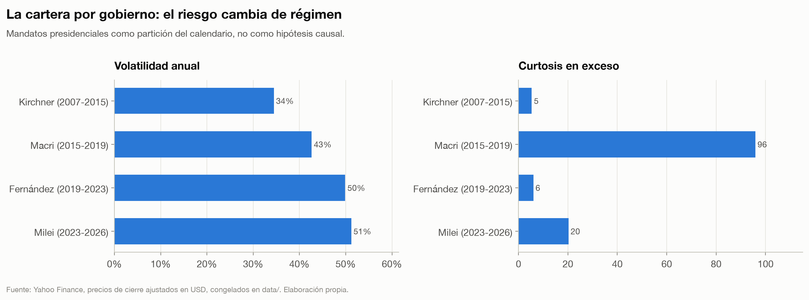

**Figura 25. Riesgo por período.** La volatilidad anual de la cartera **creció en cada período**: 34,5%, 42,6%, 49,9% y 51,2%. La curtosis de 96 del período 2015-2019 es casi entera de un día: sin las PASO baja a 6,0, en línea con los demás períodos. Esto anticipa dos cuestiones para el modelo: (i) un único juego de parámetros para 19 años puede no ser estable, y conviene un test de quiebre estructural o un modelo con cambio de régimen; (ii) las estimaciones de momentos altos son extremadamente sensibles a unos pocos días.

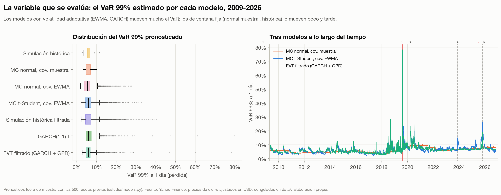

**Tabla 11. VaR 99% a un día pronosticado por cada modelo** (22/04/2009 a 30/10/2026, 4.410 ruedas; excepciones esperadas: 44).

|                               | Media   | Mediana   | Desvío   | Mín.   | Máx.   | Coef. de variación   | Excepciones   |
|:------------------------------|:--------|:----------|:---------|:-------|:-------|:---------------------|:--------------|
| Simulación histórica          | 6,25%   | 6,23%     | 1,82%    | 3,10%  | 11,36% | 0,29                 | 56            |
| MC normal, cov. muestral      | 5,96%   | 5,70%     | 1,65%    | 3,14%  | 10,32% | 0,28                 | 63            |
| MC normal, cov. EWMA          | 5,68%   | 5,42%     | 2,63%    | 1,97%  | 27,68% | 0,46                 | 62            |
| MC t-Student, cov. EWMA       | 6,32%   | 5,98%     | 2,96%    | 2,17%  | 32,71% | 0,47                 | 45            |
| Simulación histórica filtrada | 6,39%   | 5,73%     | 3,51%    | 2,18%  | 40,16% | 0,55                 | 51            |
| GARCH(1,1)-t                  | 6,31%   | 6,08%     | 2,74%    | 3,02%  | 79,67% | 0,43                 | 45            |
| EVT filtrado (GARCH + GPD)    | 6,10%   | 5,91%     | 2,72%    | 2,68%  | 78,17% | 0,45                 | 52            |

**Figura 26. La variable que se evalúa.** Los siete modelos tienen un VaR **medio parecido** (5,7% a 6,4%), cercano al percentil 1 incondicional de la cartera (6,4%). La diferencia entre ellos no está en el nivel promedio, sino en **cuánto y cuándo se mueven**:

- El coeficiente de variación va de 0,28-0,29 en los modelos de ventana fija (normal con covarianza muestral y simulación histórica) a 0,43-0,55 en los que tienen volatilidad adaptativa.
- Los dos modelos de ventana fija nunca superan 11,4% de VaR. Los modelos GARCH llegan a 78-80% el 13/08/2019, el día después de las PASO, porque su volatilidad condicional explota con un retorno de 18 desvíos.

Que el promedio sea similar y la dispersión muy distinta es la razón por la que el estudio necesita tests de **independencia** (Christoffersen) además de frecuencia (Kupiec).

**Tabla 12. Excepciones del VaR 99% por año** (tres modelos representativos).

| Año   | Ruedas   | Esperadas (1%)   | MC normal, cov. muestral   | MC t-Student, cov. EWMA   | EVT filtrado (GARCH + GPD)   |
|:------|:---------|:-----------------|:---------------------------|:--------------------------|:-----------------------------|
| 2009  | 177      | 1,8              | 0                          | 0                         | 0                            |
| 2010  | 252      | 2,5              | 0                          | 3                         | 3                            |
| 2011  | 252      | 2,5              | 7                          | 5                         | 5                            |
| 2012  | 250      | 2,5              | 4                          | 2                         | 2                            |
| 2013  | 252      | 2,5              | 4                          | 1                         | 1                            |
| 2014  | 252      | 2,5              | 4                          | 2                         | 2                            |
| 2015  | 252      | 2,5              | 3                          | 2                         | 4                            |
| 2016  | 252      | 2,5              | 0                          | 3                         | 1                            |
| 2017  | 251      | 2,5              | 2                          | 3                         | 2                            |
| 2018  | 251      | 2,5              | 20                         | 8                         | 9                            |
| 2019  | 252      | 2,5              | 5                          | 4                         | 6                            |
| 2020  | 253      | 2,5              | 4                          | 2                         | 1                            |
| 2021  | 252      | 2,5              | 0                          | 1                         | 2                            |
| 2022  | 251      | 2,5              | 3                          | 3                         | 4                            |
| 2023  | 250      | 2,5              | 3                          | 1                         | 4                            |
| 2024  | 252      | 2,5              | 1                          | 1                         | 1                            |
| 2025  | 250      | 2,5              | 3                          | 3                         | 5                            |
| 2026  | 209      | 2,1              | 0                          | 1                         | 0                            |

**Lectura.** Esta es la tabla de frecuencias de la variable binaria $I_t$. Con un modelo correcto, cada año debería tener unas 2,5 excepciones, con variaciones al azar. El Monte Carlo normal con covarianza muestral concentra **20 excepciones en 2018** (la crisis cambiaria), 8 veces lo esperado, y ninguna en 2009, 2010, 2016, 2021 ni 2026: las excepciones vienen en **racimos**. Los modelos con volatilidad adaptativa también fallan más en 2018 (8 y 9 excepciones), pero las reparten mejor entre años. Es la versión descriptiva del rechazo del test de Christoffersen que reporta el estudio.

---

## 2.14 Estacionalidad

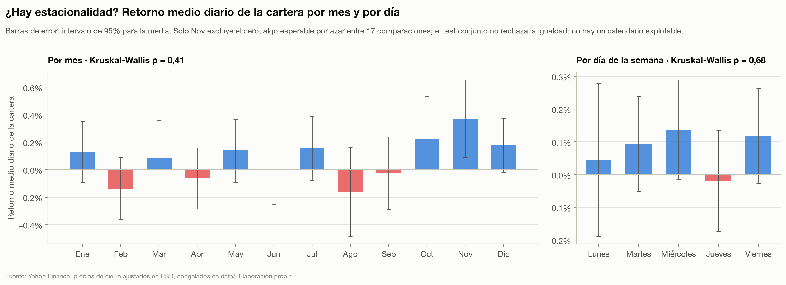

**Tabla 18. Retorno de la cartera por mes.**

| Mes   | Ruedas   | Retorno medio diario   | Desvío diario   | Error estándar   | Positivos   |
|:------|:---------|:-----------------------|:----------------|:-----------------|:------------|
| Ene   | 384      | 0,131%                 | 2,215%          | 0,113%           | 52,1%       |
| Feb   | 365      | -0,137%                | 2,221%          | 0,116%           | 51,5%       |
| Mar   | 414      | 0,086%                 | 2,867%          | 0,141%           | 54,6%       |
| Abr   | 397      | -0,063%                | 2,264%          | 0,114%           | 49,1%       |
| May   | 422      | 0,140%                 | 2,404%          | 0,117%           | 50,7%       |
| Jun   | 423      | 0,005%                 | 2,683%          | 0,130%           | 49,6%       |
| Jul   | 425      | 0,156%                 | 2,431%          | 0,118%           | 51,8%       |
| Ago   | 441      | -0,161%                | 3,457%          | 0,165%           | 49,9%       |
| Sep   | 409      | -0,026%                | 2,733%          | 0,135%           | 51,1%       |
| Oct   | 442      | 0,225%                 | 3,283%          | 0,156%           | 50,9%       |
| Nov   | 387      | 0,372%                 | 2,839%          | 0,144%           | 53,2%       |
| Dic   | 401      | 0,181%                 | 2,009%          | 0,100%           | 53,4%       |

**Tabla 19. Retorno de la cartera por día de la semana.**

| Día       | Ruedas   | Retorno medio diario   | Desvío diario   | Error estándar   | Positivos   |
|:----------|:---------|:-----------------------|:----------------|:-----------------|:------------|
| Lunes     | 922      | 0,045%                 | 3,606%          | 0,119%           | 50,3%       |
| Martes    | 1.009    | 0,094%                 | 2,349%          | 0,074%           | 51,0%       |
| Miércoles | 1.007    | 0,138%                 | 2,456%          | 0,077%           | 53,5%       |
| Jueves    | 988      | -0,019%                | 2,474%          | 0,079%           | 50,4%       |
| Viernes   | 984      | 0,119%                 | 2,323%          | 0,074%           | 51,9%       |

**Figura 27. ¿Hay un calendario en los retornos?** Se agrupan los retornos diarios de la cartera por mes y por día de la semana, y se testea si todas las distribuciones son iguales con Kruskal-Wallis, un test no paramétrico que no supone normalidad.

- **Por mes** (p = 0,41) y **por día** (p = 0,68), el test **no rechaza** la igualdad.
- De las 17 medias, solo la de noviembre tiene un intervalo de 95% que excluye el cero. Con 17 comparaciones es esperable que alguna lo haga por azar (1 de cada 20), y además noviembre incluye dos días electorales (balotaje 2023 y su semana).
- Lo que sí cambia entre grupos es la **volatilidad**. Agosto (3,5%) y octubre (3,3%) tienen los desvíos más altos porque concentran las PASO y las elecciones generales y legislativas. El lunes tiene un desvío de 3,6%, contra 2,3% a 2,5% del resto de los días, porque las elecciones argentinas son los domingos y su efecto se ve el lunes.

**Implicancia:** no hay estacionalidad explotable en la **media**, pero sí un patrón en la **volatilidad** asociado al calendario electoral. Un modelo de volatilidad podría incluir variables dummy de lunes postelectorales.

---

## 2.15 Preparación para el modelo econométrico

El capítulo siguiente modela la volatilidad de la cartera con un modelo de la familia GARCH. Antes hay que responder tres preguntas: ¿qué serie se modela, los precios o los retornos? ¿Hace falta una ecuación para la media? ¿Hay evidencia de heterocedasticidad condicional?

### Estacionariedad

**Tabla 13. Tests de raíz unitaria (ADF) y de estacionariedad (KPSS).** ADF: $H_0$ raíz unitaria, con tendencia en log-precios y con constante en retornos. KPSS: $H_0$ estacionariedad. El p-valor de KPSS está acotado entre 0,01 y 0,10 por su tabla de valores críticos.

|               | ADF log-precio   | ADF log-precio p   | KPSS log-precio   | KPSS log-precio p   | ADF retorno   | ADF retorno p   | KPSS retorno   | KPSS retorno p   |
|:--------------|:-----------------|:-------------------|:------------------|:--------------------|:--------------|:----------------|:---------------|:-----------------|
| GGAL          | -2,39            | 0,384              | 0,71              | 0,010               | -13,59        | < 0,001         | 0,09           | 0,100            |
| BMA           | -2,14            | 0,523              | 0,68              | 0,010               | -23,91        | < 0,001         | 0,11           | 0,100            |
| BBAR          | -1,89            | 0,657              | 0,85              | 0,010               | -72,72        | < 0,001         | 0,10           | 0,100            |
| YPF           | -1,45            | 0,847              | 1,07              | 0,010               | -32,29        | < 0,001         | 0,20           | 0,100            |
| TGS           | -2,46            | 0,346              | 0,54              | 0,010               | -30,87        | < 0,001         | 0,15           | 0,100            |
| EDN           | -2,12            | 0,534              | 0,53              | 0,010               | -18,66        | < 0,001         | 0,13           | 0,100            |
| TEO           | -2,46            | 0,349              | 0,82              | 0,010               | -29,38        | < 0,001         | 0,06           | 0,100            |
| CRESY         | -2,37            | 0,395              | 0,59              | 0,010               | -69,24        | < 0,001         | 0,12           | 0,100            |
| Cartera       | -1,93            | 0,639              | 0,66              | 0,010               | -28,59        | < 0,001         | 0,15           | 0,100            |
| S&P 500 (SPY) | -3,92            | 0,011              | 0,57              | 0,010               | -17,51        | < 0,001         | 0,20           | 0,100            |

**Lectura.** ADF y KPSS se leen juntos (Recuadro 6):

- **Log-precios.** ADF **no rechaza** la raíz unitaria en ningún ADR ni en la cartera (p entre 0,34 y 0,85), y KPSS **rechaza** la estacionariedad en todos (p ≤ 0,01). Los dos tests coinciden: los log-precios son **I(1)**. El SPY es un caso ambiguo, porque ADF rechaza al 5% (p = 0,011, con tendencia) y KPSS también rechaza. Es habitual en series con una tendencia muy fuerte y no cambia nada para este estudio, porque no se modelan precios.
- **Retornos.** ADF rechaza la raíz unitaria con p < 0,001 en todos los casos, y KPSS no rechaza la estacionariedad (p ≥ 0,10). Los retornos son **I(0)**.

**Implicancia:** el modelo se especifica sobre **retornos**. Una regresión con precios en niveles sería espuria. Esto también confirma que es coherente estimar sobre ventanas de retornos, como hace el estudio.

### Autocorrelación de los retornos y de su magnitud

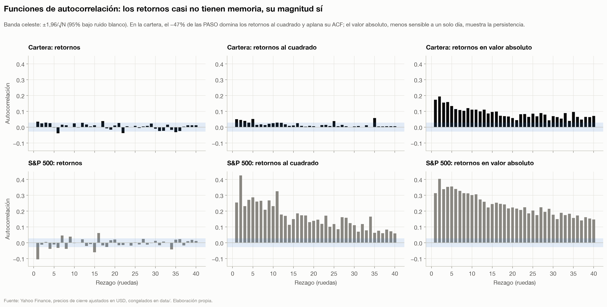

**Tabla 14. Autocorrelación (Ljung-Box) y efectos ARCH (test LM de Engle).**

|               | ACF(1) retorno   | Q(10) retorno   | Q(10) p   | ACF(1) retorno²   | Q(10) retorno²   | Q²(10) p   | ACF(1) valor abs.   | Q(10) valor abs.   | ARCH-LM(10)   | ARCH-LM p   |
|:--------------|:-----------------|:----------------|:----------|:------------------|:-----------------|:-----------|:--------------------|:-------------------|:--------------|:------------|
| GGAL          | 0,002            | 32,9            | < 0,001   | 0,049             | 81,0             | < 0,001    | 0,151               | 751,3              | 61,8          | < 0,001     |
| BMA           | -0,010           | 16,6            | 0,083     | 0,079             | 113,9            | < 0,001    | 0,170               | 802,6              | 83,7          | < 0,001     |
| BBAR          | -0,037           | 17,3            | 0,069     | 0,101             | 105,8            | < 0,001    | 0,198               | 775,9              | 82,5          | < 0,001     |
| YPF           | 0,030            | 27,8            | 0,002     | 0,108             | 278,5            | < 0,001    | 0,203               | 1.146,9            | 183,3         | < 0,001     |
| TGS           | -0,049           | 28,3            | 0,002     | 0,067             | 65,5             | < 0,001    | 0,178               | 632,0              | 52,5          | < 0,001     |
| EDN           | 0,007            | 18,2            | 0,052     | 0,085             | 133,4            | < 0,001    | 0,214               | 863,3              | 101,3         | < 0,001     |
| TEO           | 0,006            | 11,8            | 0,298     | 0,160             | 224,2            | < 0,001    | 0,190               | 771,7              | 171,0         | < 0,001     |
| CRESY         | 0,012            | 11,3            | 0,337     | 0,072             | 140,7            | < 0,001    | 0,203               | 1.011,4            | 97,4          | < 0,001     |
| Cartera       | 0,035            | 28,0            | 0,002     | 0,050             | 56,1             | < 0,001    | 0,173               | 967,6              | 45,0          | < 0,001     |
| S&P 500 (SPY) | -0,105           | 93,2            | < 0,001   | 0,254             | 3.738,8          | < 0,001    | 0,313               | 5.581,9            | 1.251,7       | < 0,001     |

*Q(10): estadístico de Ljung-Box con 10 rezagos, $H_0$: sin autocorrelación hasta el rezago 10. ARCH-LM(10): regresión de $r_t^2$ sobre 10 rezagos propios, $H_0$: sin efectos ARCH.*

**Figura 28. Funciones de autocorrelación.**

1. **Los retornos casi no tienen memoria.** La autocorrelación de primer orden de cada ADR está entre −0,05 y +0,03: no sirve para predecir la dirección del día siguiente. Ljung-Box rechaza al 5% en GGAL, YPF, TGS, la cartera y el SPY, pero hay que tomarlo con cautela. Con heterocedasticidad, el test de Ljung-Box estándar **rechaza de más**, porque los períodos de alta volatilidad inflan las autocorrelaciones muestrales. Antes de agregar términos ARMA conviene repetirlo sobre los residuos estandarizados del GARCH. La excepción es el SPY, con −0,105 en el primer rezago, un efecto conocido de reversión de corto plazo en índices.
2. **La magnitud de los retornos sí tiene memoria, y mucha.** Ljung-Box sobre los retornos al cuadrado rechaza con p < 0,001 en todas las series, y el ARCH-LM también (estadísticos de 45 a 183 en los activos argentinos). La autocorrelación del **valor absoluto** está entre 0,15 y 0,21 en el primer rezago y sigue siendo positiva 40 ruedas después: la volatilidad es **muy persistente**.
3. **Un detalle técnico sobre la cartera.** Su ACF de retornos al cuadrado es baja (0,05) porque un solo día, el −47% de las PASO, domina la serie de cuadrados: ese día al cuadrado pesa más que cientos de días normales y "aplana" las autocorrelaciones. Sin ese día, el ARCH-LM de la cartera sube de 45 a 144 y la ACF(1) de los cuadrados, de 0,05 a 0,08. El valor absoluto, menos sensible a un solo día, muestra la persistencia con claridad (0,17). Es otra muestra de cómo un evento político domina las estimaciones.

### Qué sugieren estos resultados para el modelo

| Hallazgo descriptivo | Implicancia para la especificación |
|---|---|
| Precios I(1), retornos I(0) | Modelar retornos, no precios |
| Media diaria ≈ 0, autocorrelación pequeña y sin estacionalidad en la media | Ecuación de la media con constante o, a lo sumo, AR(1); confirmar con Ljung-Box sobre residuos estandarizados |
| ARCH-LM y Ljung-Box sobre $r^2$ rechazan en todas las series | Hace falta varianza condicional: **GARCH(1,1)** como punto de partida |
| ACF de $\lvert r \rvert$ positiva hasta 40 rezagos | Se espera alta persistencia (α + β cercano a 1). Contrastar con IGARCH, que es el modelo implícito en la EWMA con λ = 0,94 del estudio, y considerar memoria larga (FIGARCH) si la persistencia es extrema |
| Curtosis de 14 a 30, ν de la t entre 3 y 4, días a más de 5 desvíos | Innovaciones **t-Student** (o t asimétrica) en lugar de normales. Verificar si los residuos estandarizados siguen teniendo colas gruesas, lo que justificaría EVT sobre los residuos, como en el modelo EVT filtrado del estudio |
| Asimetría ≈ 0 en los ADRs; la de la cartera viene de un solo día; saltos positivos tan grandes como los negativos | Testear el efecto apalancamiento (**GJR-GARCH** o **EGARCH**). Por lo descriptivo, se espera que sea débil |
| Saltos políticos desde volatilidad baja; desvío del lunes y de los meses electorales más alto | Ningún GARCH los anticipa. Considerar dummies de días postelectorales en la media y/o la varianza, o un modelo con saltos, y declarar el resto como límite del modelo |
| Volatilidad media creciente entre períodos; cambio de nivel desde 2018 | Testear estabilidad de parámetros (quiebre estructural) o un GARCH con cambio de régimen (Markov-switching) |
| Correlaciones que suben en crisis locales; coexcedencias mayores que las de la normal | Para modelar la cartera desde sus componentes: correlación dinámica (**DCC-GARCH**) con innovaciones t multivariadas, o una cópula t |

**Propuesta para el capítulo siguiente.** Estimar sobre la muestra completa un **AR(0)-GARCH(1,1) con innovaciones t-Student** para la cartera, y compararlo con GJR-GARCH-t, EGARCH-t e IGARCH por AIC/BIC y por log-verosimilitud fuera de muestra. Diagnosticar los residuos estandarizados con Ljung-Box sobre $z$ y $z^2$, ARCH-LM y un QQ-plot contra la t. Repetirlo con y sin las PASO (o con una dummy) para medir cuánto depende la estimación de ese día. El estudio de VaR ya usa un GARCH(1,1)-t re-estimado cada 21 días; el capítulo econométrico le daría la base formal que hoy no tiene.

---

## 2.16 Conclusiones del capítulo

El análisis descriptivo deja diez conclusiones, cada una con su consecuencia para la medición del riesgo:

1. **Los retornos de los ADRs argentinos no son normales, y no lo son por mucho.** La curtosis va de 14 a 18 en cada activo y llega a 30 en la cartera. Jarque-Bera rechaza con estadísticos de decenas de miles, y hay entre 9 y 14 días a más de 5 desvíos por activo cuando la normal predice 0,003. *Consecuencia:* cualquier modelo de VaR con innovaciones normales subestima el riesgo de cola.
2. **Las colas son gruesas en las dos direcciones.** La asimetría de cada ADR es cercana a cero, y los mejores días (+35% la cartera) son casi tan extremos como los peores. *Consecuencia:* una distribución simétrica de colas gruesas, como la t, es una buena primera aproximación; el efecto apalancamiento probablemente sea débil.
3. **Los días extremos son, sobre todo, políticos y locales.** De los diez peores días de la cartera, cuatro son shocks argentinos puros, con el S&P 500 casi quieto. De los diez mejores, nueve son locales. *Consecuencia:* los saltos ocurren desde volatilidad baja y ningún modelo estadístico los anticipa. Para eso están el ES y los escenarios de estrés.
4. **La volatilidad cambia de nivel y persiste.** La volatilidad EWMA va de 0,9% a 11,8% diario, y la autocorrelación de los retornos en valor absoluto sigue siendo positiva después de 40 ruedas. *Consecuencia:* el VaR tiene que reaccionar a la volatilidad reciente (EWMA o GARCH).
5. **El régimen de riesgo empeoró con el tiempo.** La volatilidad anual de la cartera pasó de 34,5% (2007-2015) a 51,2% (2023-2026), y desde 2018 nunca bajó de 37% en un año calendario. *Consecuencia:* hay que testear la estabilidad de los parámetros del modelo.
6. **La diversificación entre ADRs argentinos es limitada y desaparece en las crisis.** La correlación promedio es 0,53 en toda la muestra y llega a 0,88 después de un shock político. Las coexcedencias en la cola son 37%, contra 27% de una normal con la misma correlación, y los ocho activos cayeron juntos a su peor 5% en 17 días, contra 2,9 esperados. *Consecuencia:* hace falta dependencia en las colas (t multivariada o cópula t), no solo la correlación correcta.
7. **La cartera "equiponderada" es una apuesta a los bancos.** Los bancos son 37,5% del capital y aportan 44,7% de la varianza. *Consecuencia:* el riesgo de la cartera es, en buena medida, el riesgo del sistema financiero y del soberano.
8. **La rentabilidad no compensó el riesgo.** La cartera creció 10,4% anual, igual que el S&P 500, con 2,2 veces su volatilidad, una caída máxima de −86% y casi siete años bajo su máximo. Varios ADRs tienen crecimiento compuesto nulo o negativo en 19 años.
9. **No hay estacionalidad en la media, pero sí en la volatilidad**, asociada al calendario electoral: lunes, agosto y octubre.
10. **Los retornos son estacionarios y tienen efectos ARCH.** Los precios son I(1), los retornos I(0), y todas las series tienen heterocedasticidad condicional significativa. *Consecuencia:* el punto de partida del modelo econométrico es un GARCH(1,1) con innovaciones t-Student sobre los retornos de la cartera.

En conjunto, estos hechos explican el resultado principal del estudio: los modelos que aprueban el backtest (MC t con EWMA, simulación histórica filtrada, GARCH-t y EVT filtrado) son los que incorporan **colas gruesas** (conclusiones 1, 2 y 6) y **volatilidad que reacciona** (conclusión 4). Ninguno de ellos resuelve la conclusión 3.

---

## 2.17 Limitaciones

- **Un solo día domina varios estadísticos.** La asimetría, la curtosis y la ACF de los cuadrados de la cartera cambian mucho con o sin el 12/08/2019. Se reportan con ese día incluido, porque es un dato real y el riesgo que el estudio quiere medir, y se aclara el efecto donde importa.
- **Precios con días sin operaciones y algunos datos sospechosos.** Entre el 0,6% y el 4,4% de las ruedas tienen retorno exactamente cero, sobre todo en TGS y EDN. Puede tratarse de iliquidez o de precios no actualizados, que subestiman la volatilidad esos días y agregan un pico artificial en cero. El par de días del 17 y 18/12/2008 de BBAR (+38,9% y −20,9%) parece un problema de datos o de liquidez y se conserva tal como viene de la fuente.
- **Etiquetas de eventos.** Solo se etiquetaron fechas con una causa pública clara. Los días sin etiqueta ("–") pueden responder a noticias específicas de cada empresa que no se investigaron. La asignación de una causa a un día es interpretativa, no un test.
- **Supervivencia y selección.** Son empresas que hoy siguen cotizando, elegidas por quien hace el estudio. Un universo que incluyera a las que dejaron de cotizar mostraría colas todavía más gruesas.
- **Correlación de Pearson y coexcedencias.** Pearson resume la dependencia lineal promedio. Las coexcedencias al 5% describen la dependencia en la cola, pero dependen del umbral elegido y no son un coeficiente de dependencia de cola en el límite (que requiere un modelo, por ejemplo una cópula).
- **KPSS acotado.** Los p-valores de KPSS están truncados entre 0,01 y 0,10 por la tabla de valores críticos de statsmodels: "0,100" significa "≥ 0,10" y "0,010" significa "≤ 0,01".
- **Contexto macroeconómico.** La sección 2.3 es un resumen para interpretar los datos, no un análisis causal. Los mandatos presidenciales son una partición del calendario.

---

### Archivos

```
estudio/descriptivo/
├── run_descriptivo.py        script reproducible (uv run python estudio/descriptivo/run_descriptivo.py)
├── ANALISIS_DESCRIPTIVO.md   este capítulo
├── tablas.md                 todas las tablas, generadas por el script
├── tablas/*.csv              las mismas tablas sin formato, para reutilizar
└── figuras/
    ├── d01 … d19             figuras generales
    └── activos/a01 … a09     una ficha gráfica por activo y para la cartera
```

### Referencias

- Bollerslev, T. (1986), *Generalized autoregressive conditional heteroskedasticity*, Journal of Econometrics.
- Cont, R. (2001), *Empirical properties of asset returns: stylized facts and statistical issues*, Quantitative Finance.
- Dickey, D. y Fuller, W. (1979), *Distribution of the estimators for autoregressive time series with a unit root*, Journal of the American Statistical Association.
- Engle, R. (1982), *Autoregressive conditional heteroscedasticity with estimates of the variance of United Kingdom inflation*, Econometrica.
- Jarque, C. y Bera, A. (1980), *Efficient tests for normality, homoscedasticity and serial independence of regression residuals*, Economics Letters.
- J.P. Morgan/Reuters (1996), *RiskMetrics Technical Document*.
- Kruskal, W. y Wallis, W. A. (1952), *Use of ranks in one-criterion variance analysis*, Journal of the American Statistical Association.
- Kwiatkowski, D., Phillips, P., Schmidt, P. y Shin, Y. (1992), *Testing the null hypothesis of stationarity against the alternative of a unit root*, Journal of Econometrics.
- Ljung, G. y Box, G. (1978), *On a measure of lack of fit in time series models*, Biometrika.
- McNeil, A., Frey, R. y Embrechts, P. (2015), *Quantitative Risk Management: Concepts, Techniques and Tools*, Princeton University Press.
